# Scenario 1: Vấn đề đăng nhập LMS (Standard)

Odoo Helpdesk: https://nv-cuong.odoo.com (đội **MindX Tech Support**). Tình huống training giả định: kết quả kiểm tra Base và log là giả định, khách hàng là liên hệ giả với email `@example.com`, nên dấu ⊗ đỏ cạnh email trong chatter là thư không gửi đi được (cố ý, để không gửi tới người thật).

| Ticket | Trường hợp | Link |
|---|---|---|
| #00001 | Deactivated → nhân sự **còn làm việc** → kích hoạt lại + reset mật khẩu | `<link ticket #00001>` |
| #00002 | **Active** → hướng dẫn tự đặt lại mật khẩu | `<link ticket #00002>` |
| #00003 | Deactivated → nhân sự **đã nghỉ việc** → không kích hoạt lại, giải thích và đóng | `<link ticket #00003>` |

## Giải thích phân loại

**Class of Service: Standard** (ưu tiên 0 sao; thẻ `lms`, `login`, `teacher`). Chỉ 1 người dùng bị ảnh hưởng (< 5), lỗi ở cấp tài khoản cá nhân, log đăng nhập không có lỗi hàng loạt nên không phải sự cố hệ thống. Giáo viên cần tài liệu cho buổi học hôm nay nên được phản hồi sớm trong mốc 30 phút, nhưng mức phân loại vẫn dựa trên **mức ảnh hưởng**.

---

## Ticket #00001: Deactivated, còn làm việc

### Bước 1: Tiếp nhận

Tạo ticket (tiêu đề, khách hàng, phân công, ưu tiên, thẻ, mô tả) và ghi chú lý do phân loại.

<!-- ẢNH: form ticket + ghi chú [Tiếp nhận] -->
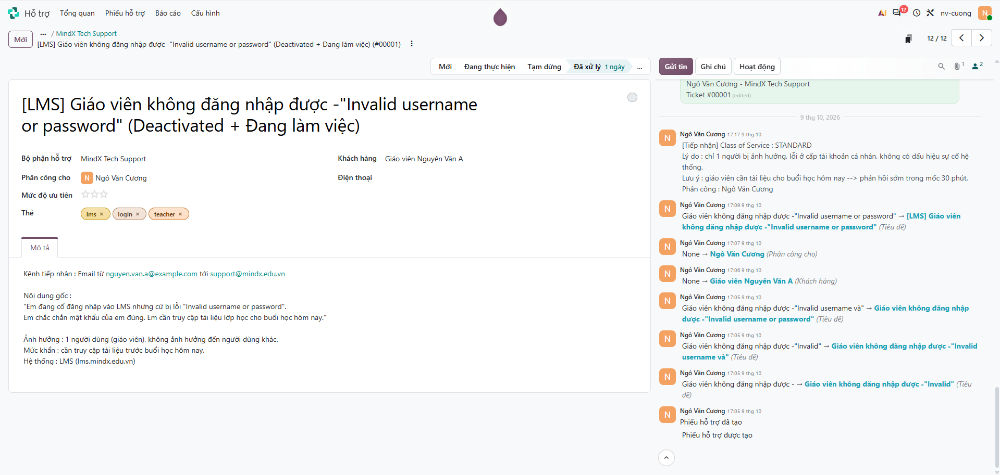

### Bước 2: Phản hồi ban đầu

Gửi email xác nhận đã nhận, chuyển ticket sang **Đang thực hiện**.

<!-- ẢNH: email xác nhận + dòng "Mới → Đang thực hiện" -->
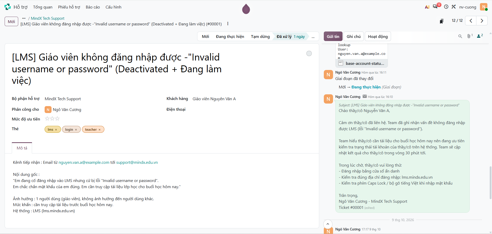

> Email xác nhận của ticket này gửi trễ (ticket tạo ngày 09/10, phản hồi ngày 10/10) do làm bài gián đoạn. Với Standard, email xác nhận phải gửi trong 30 phút; ticket #00002 và #00003 được xử lý liên tục để thể hiện đúng mốc này.

### Bước 3: Chẩn đoán

Kiểm tra Base (DEACTIVATED, nhân sự đang làm việc) và log đăng nhập; quyết định chưa kích hoạt lại; xác minh với HR qua Teams.

<!-- ẢNH: ghi chú [Chẩn đoán] + ghi chú [Xác minh] + file bằng chứng đính kèm -->
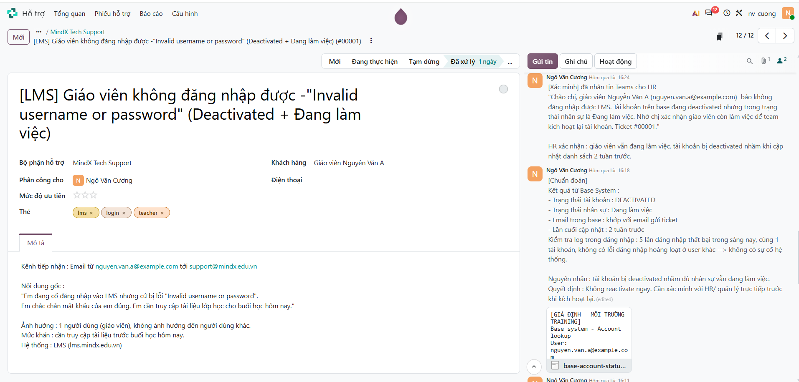

### Bước 4: Giải quyết

Kích hoạt lại tài khoản, reset mật khẩu, tự kiểm tra; ghi thời gian xử lý.

<!-- ẢNH: ghi chú [Giải quyết] -->
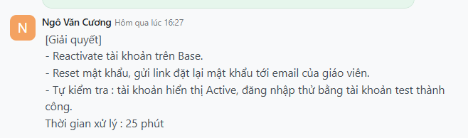

### Bước 5: Giao tiếp

Gửi email thông báo kết quả và các bước giáo viên cần làm; chuyển ticket sang **Tạm dừng** (chờ xác nhận).

<!-- ẢNH: email giải quyết + dòng "Đang thực hiện → Tạm dừng" -->
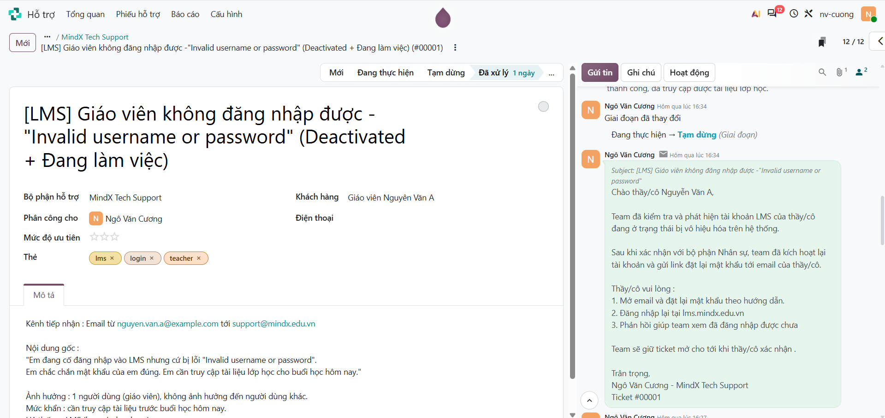

### Bước 6: Theo dõi

Ghi nhận giáo viên xác nhận đăng nhập thành công, gửi email theo dõi, chuyển ticket sang **Đã xử lý**.

<!-- ẢNH: ghi chú [Theo dõi] + email theo dõi + dòng "Tạm dừng → Đã xử lý" -->
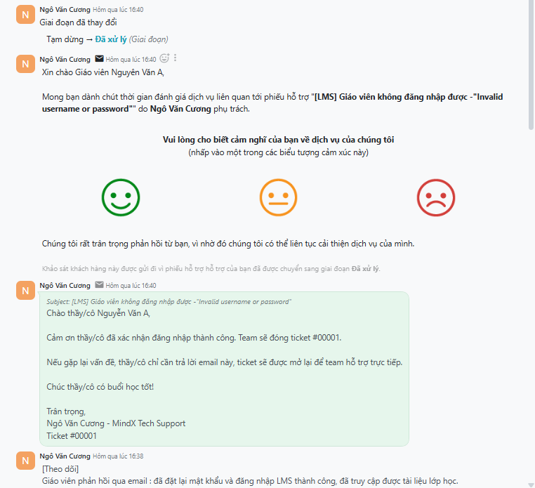

### Bước 7: Phân tích và automation

Ghi nguyên nhân gốc, mẫu lặp lại và đề xuất tự động hoá.

<!-- ẢNH: ghi chú [Phân tích & Automation] -->
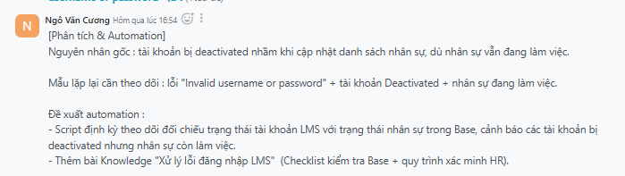

---

## Ticket #00002: Active

### Bước 1: Tiếp nhận

Tạo ticket và ghi chú lý do phân loại.

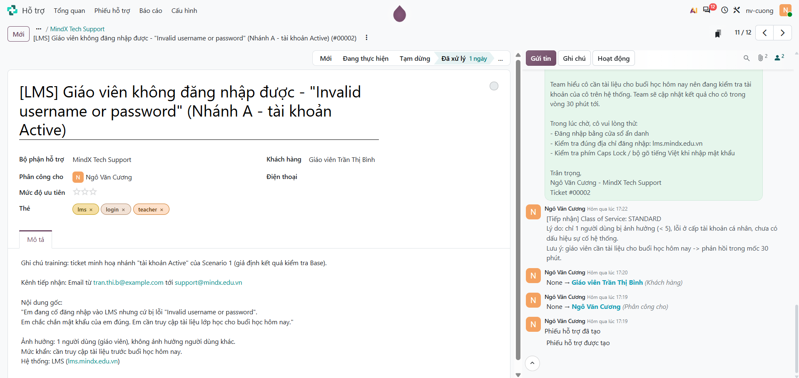

### Bước 2: Phản hồi ban đầu

Gửi email xác nhận trong 30 phút, chuyển sang **Đang thực hiện**.

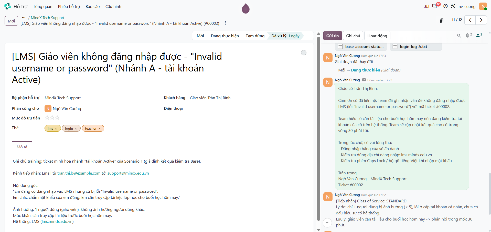

### Bước 3: Chẩn đoán

Kiểm tra Base (ACTIVE) và log đăng nhập (nhiều lần sai mật khẩu); quyết định không cần xác minh HR, hướng dẫn tự đặt lại mật khẩu.

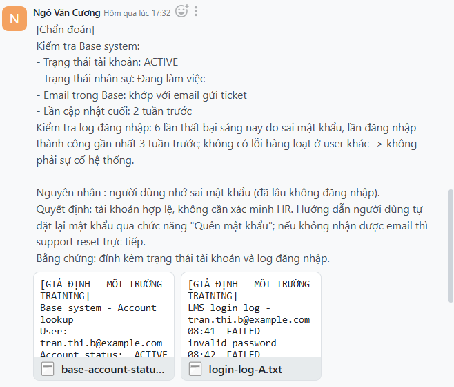

### Bước 4–5: Giải quyết và giao tiếp

Gửi hướng dẫn tự đặt lại mật khẩu (support reset trực tiếp nếu không nhận được email); chuyển sang **Tạm dừng**.

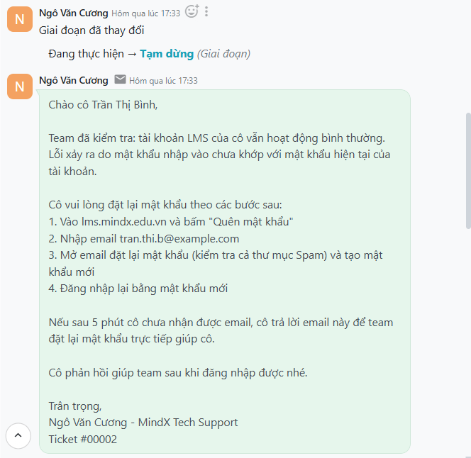

### Bước 6: Theo dõi

Ghi nhận xác nhận, gửi email theo dõi (hỏi còn cần hỗ trợ gì không), chuyển sang **Đã xử lý**.

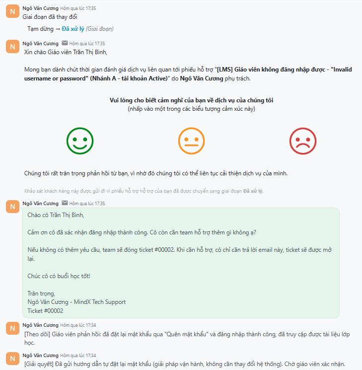

### Bước 7: Phân tích và automation

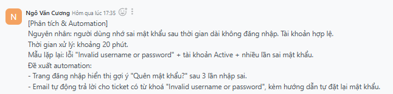

---

## Ticket #00003: Deactivated, đã nghỉ việc

### Bước 1: Tiếp nhận

Tạo ticket và ghi chú lý do phân loại.

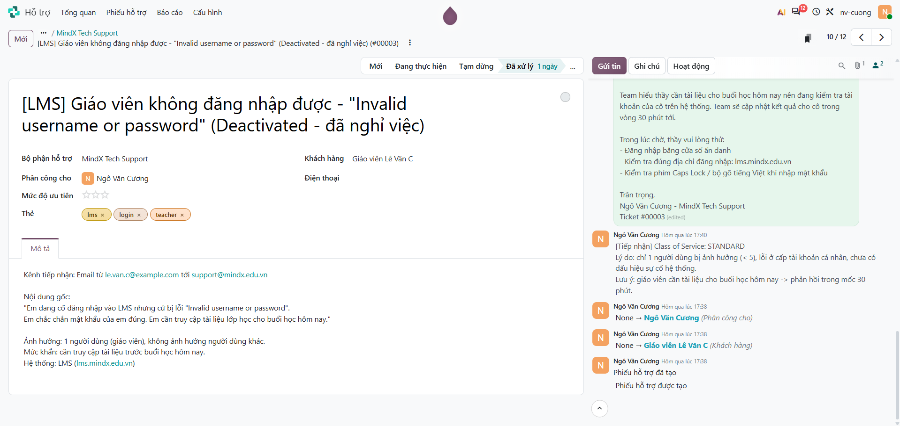

### Bước 2: Phản hồi ban đầu

Gửi email xác nhận trong 30 phút, chuyển sang **Đang thực hiện**.

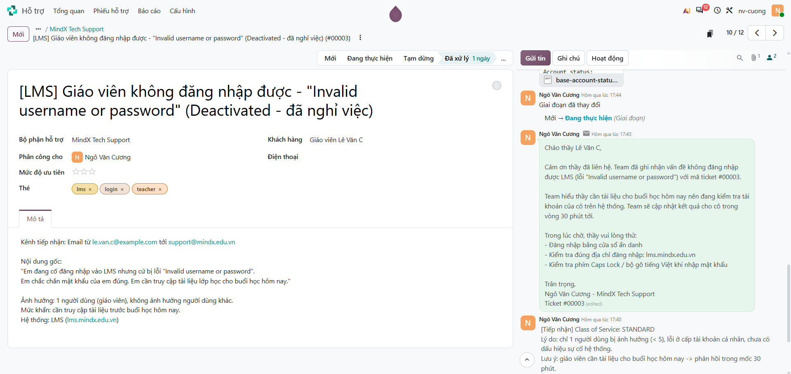

### Bước 3: Chẩn đoán

Kiểm tra Base (DEACTIVATED) và log; không kích hoạt lại khi chưa xác minh; HR xác nhận đã nghỉ việc; báo HR về lần cố đăng nhập.

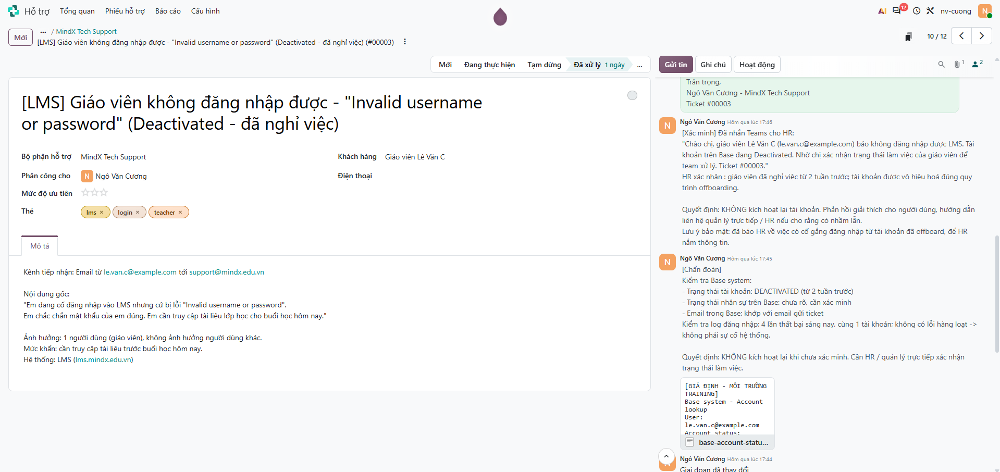

### Bước 4–5: Giải quyết và giao tiếp

Không kích hoạt lại; gửi email giải thích tài khoản đã được thu hồi theo quy trình và hướng dẫn liên hệ quản lý / HR.

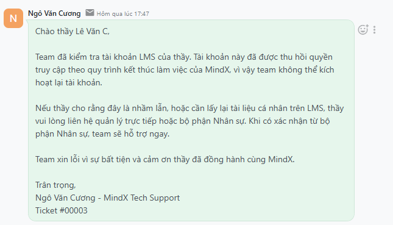

### Bước 6: Theo dõi

Ghi nhận người dùng đã hiểu, chuyển sang **Đã xử lý**.

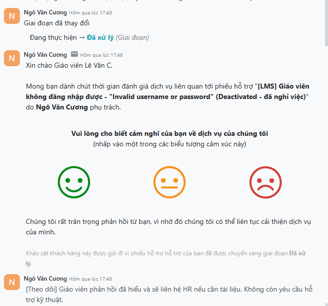

### Bước 7: Phân tích và automation

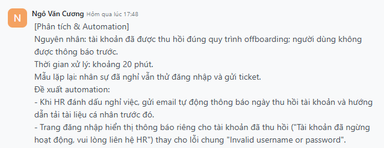

---

Bằng chứng giả lập (đính kèm trong ghi chú chẩn đoán của từng ticket): [`evidence/scenario-01/`](evidence/scenario-01/)

## Rút kinh nghiệm

<!-- Bản nháp: chỉnh lại theo trải nghiệm của bạn -->

- Phân loại theo mức ảnh hưởng, không theo cảm giác gấp: 1 người dùng vẫn là Standard, mức khẩn được xử lý bằng cách phản hồi sớm.
- Kiểm tra trạng thái tài khoản và log trước khi kết luận; log giúp loại trừ sự cố hệ thống.
- Không kích hoạt lại tài khoản khi chưa xác minh với HR: cùng một lỗi có thể dẫn tới hai kết quả ngược nhau (#00001 và #00003).
- Email cho người dùng không dùng thuật ngữ và không tiết lộ thông tin nhân sự.
- Email xác nhận phải gửi ngay trong 30 phút, kể cả khi chưa có kết quả kiểm tra.
- Có thể tự động hoá: gợi ý "Quên mật khẩu" sau nhiều lần nhập sai, đối chiếu tài khoản LMS với dữ liệu nhân sự, thông báo trước khi thu hồi tài khoản.
