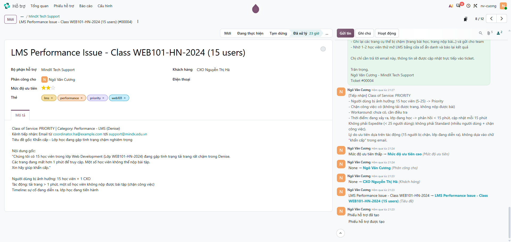
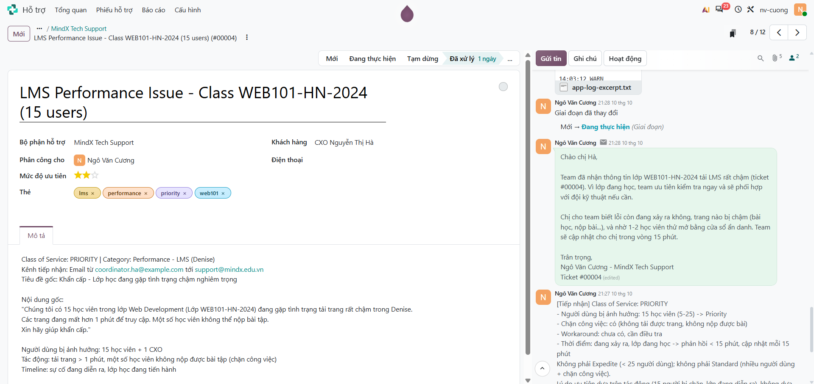
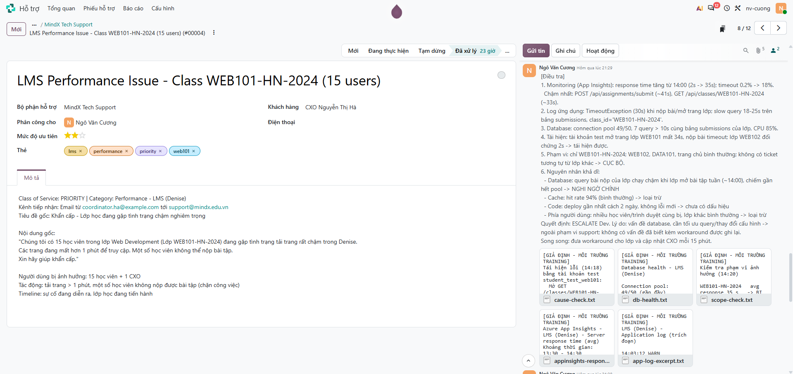
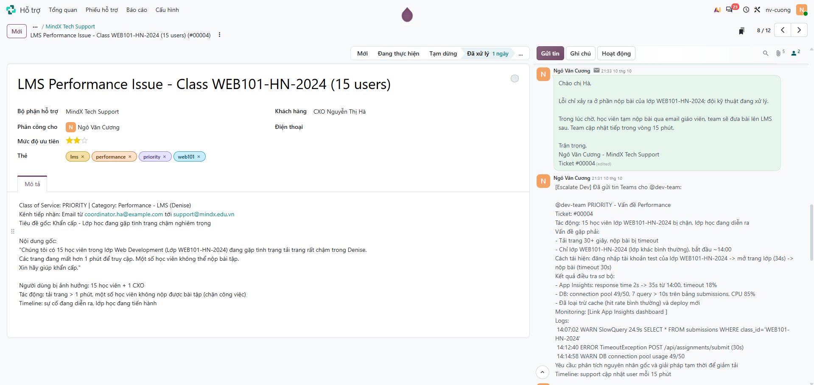
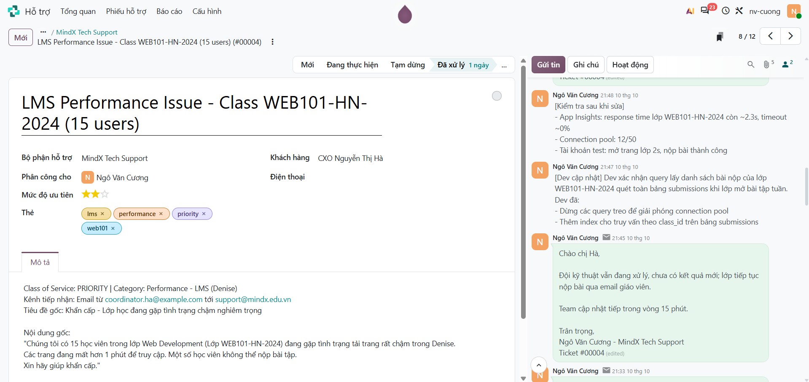
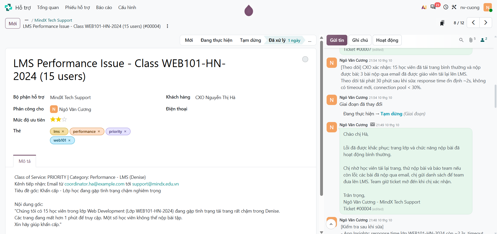
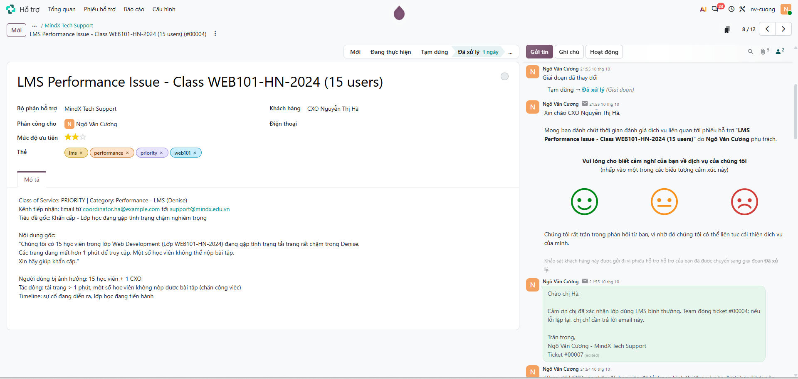
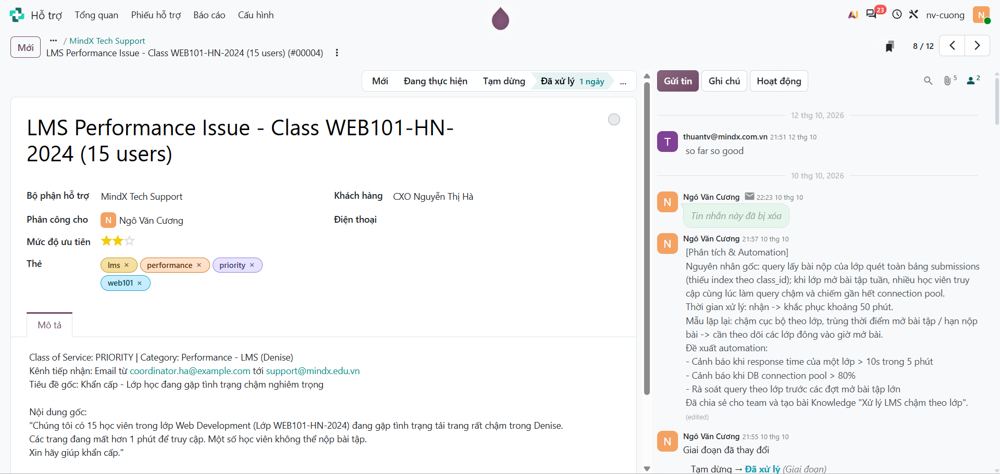
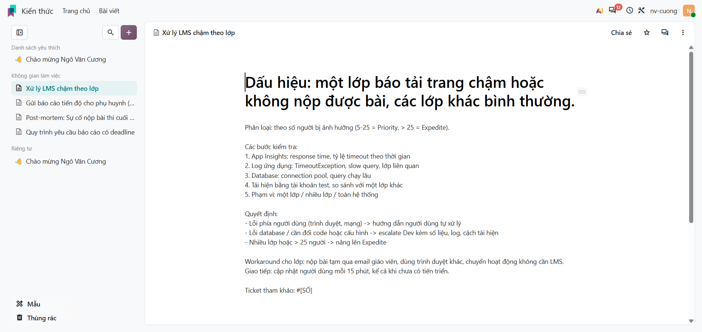

# Scenario 2: Vấn đề hiệu năng LMS (Priority)

Odoo Helpdesk: https://nv-cuong.odoo.com (đội **MindX Tech Support**). Tình huống training giả định: số liệu monitoring, log và kết quả xử lý của Dev là giả định, khách hàng là liên hệ giả với email `@example.com`, nên dấu ⊗ đỏ cạnh email trong chatter là thư không gửi đi được (cố ý, để không gửi tới người thật).

| Ticket | Nội dung | Link |
|---|---|---|
| #00004 | LMS Performance Issue - Class WEB101-HN-2024 (15 users) | `https://nv-cuong.odoo.com/odoo/helpdesk/1/tickets/4` |

## Giải thích phân loại

**Class of Service: Priority** (ưu tiên ★★ Cao; thẻ `performance`, `lms`, `priority`, `web101`).

> Quy ước ưu tiên dùng trong bài: Standard ★ · Priority ★★ · Expedite ★★★ · Fixed Deadline ★★ (theo tác động kinh doanh).

- **15 học viên** bị ảnh hưởng, nằm trong khoảng 5–25 người dùng.
- **Chặn công việc:** trang mất hơn 1 phút để tải, một số học viên không nộp được bài tập.
- **Đang diễn ra:** lớp học đang tiến hành, nên cần phản hồi trong 15 phút và cập nhật mỗi 15 phút.
- Không phải **Expedite** vì dưới 25 người dùng; không phải **Standard** vì nhiều người dùng và bị chặn công việc.

## Quyết định escalate

- **Phạm vi:** chỉ lớp WEB101-HN-2024, các lớp khác bình thường (cục bộ).
- **Nguyên nhân khả dĩ:** database (query chậm trên bảng bài nộp của lớp, connection pool 49/50). Đã loại trừ cache, code và phía người dùng.
- **Quyết định:** escalate Dev, vì đây là vấn đề database cần thay đổi query/cấu hình, vượt phạm vi support và không có workaround đã ghi nhận. Support gửi kèm dữ liệu điều tra, đưa workaround cho lớp và cập nhật CXO mỗi 15 phút.

## Timeline

> Giờ dưới đây là **giờ theo tình huống giả định** (sự cố bắt đầu ~14:00, khớp với số liệu App Insights). Giờ hệ thống hiển thị trong chatter Odoo là thời điểm thực hành.

| Giờ | Việc | Mốc yêu cầu | Bước |
|---|---|---|---|
| 14:00 | Sự cố bắt đầu (lớp mở bài tập tuần) | | — |
| 14:18 | Nhận email CXO | | 1 |
| 14:22 | Tạo ticket, ghi chú phân loại | Ghi nhận < 10 phút (4 phút) | 1 |
| 14:30 | **Email 1 – Xác nhận**, chuyển Đang thực hiện | < 15 phút từ khi nhận (12 phút) | 2 |
| 14:38 | Ghi chú điều tra + 5 file bằng chứng | | 3 |
| 14:41 | Ghi chú escalate Dev (tin nhắn Teams) | | 4 |
| 14:44 | **Email 2 – Cập nhật: escalate + workaround** | ≤ 15 phút sau email 1 (14 phút) | 4 |
| 14:58 | **Email 3 – Cập nhật: chưa có tiến triển** | ≤ 15 phút sau email 2 (14 phút) | 5 |
| 15:05 | Ghi chú Dev đã sửa | | 5 |
| 15:08 | Ghi chú tự kiểm tra sau khi sửa | | 5 |
| 15:12 | **Email 4 – Đã khắc phục, nhờ xác nhận**, chuyển Tạm dừng | ≤ 15 phút sau email 3 (14 phút) | 5 |
| 15:42 | Ghi chú CXO xác nhận + theo dõi tái phát 30 phút | | 6 |
| 15:45 | **Email 5 – Follow-up**, chuyển Đã xử lý | | 6 |
| 15:55 | Ghi chú phân tích + bài Knowledge | | 7 |

Tổng thời gian từ lúc nhận đến lúc khắc phục và tự kiểm tra: 14:18 → 15:08 = **50 phút**.

---

## Bước 1: Tiếp nhận và phân loại

Tạo ticket (tiêu đề, khách hàng, phân công, ưu tiên ★★, thẻ, mô tả có Class of Service, số người bị ảnh hưởng và timeline) và ghi chú lý do phân loại.

<!-- ẢNH: form ticket + ghi chú [Tiếp nhận] -->

## Bước 2: Phản hồi ban đầu (< 15 phút)

Email 1: xác nhận đã nhận và mức ưu tiên, đang điều tra ngay, sẽ phối hợp dev team nếu cần, hẹn cập nhật sau 15 phút, xin thêm thông tin. Chuyển ticket sang **Đang thực hiện**.

<!-- ẢNH: email 1 + dòng "Mới → Đang thực hiện" -->

## Bước 3: Điều tra

Kiểm tra App Insights, log ứng dụng, sức khoẻ database; tái hiện lỗi bằng tài khoản test; xác định phạm vi cục bộ một lớp; loại trừ cache, code và phía người dùng; quyết định escalate.

<!-- ẢNH: ghi chú [Điều tra] + 5 file bằng chứng đính kèm -->

## Bước 4: Escalate và workaround

Gửi tin nhắn Teams cho Dev (ghi lại trong ghi chú) gồm tác động, cách tái hiện, số liệu, log, mức khẩn. Email 2: báo đã chuyển đội kỹ thuật và đưa workaround cho lớp học.

<!-- ẢNH: ghi chú [Escalate Dev] + email 2 -->

## Bước 5: Giao tiếp và giải quyết

Email 3: cập nhật đúng hẹn dù chưa có tiến triển.

<!-- ẢNH: email 3 -->

Ghi nhận Dev đã sửa, tự kiểm tra lại số liệu và thao tác. Email 4: đã khắc phục, nhờ xác nhận. Chuyển ticket sang **Tạm dừng**.

<!-- ẢNH: ghi chú [Dev cập nhật] + ghi chú [Kiểm tra sau khi sửa] + email 4 + dòng "Đang thực hiện → Tạm dừng" -->

## Bước 6: Theo dõi

Ghi nhận CXO xác nhận, theo dõi tái phát. Email 5: hỏi còn cần hỗ trợ không, đóng ticket. Chuyển sang **Đã xử lý** (Odoo tự gửi email đánh giá).

<!-- ẢNH: ghi chú [Theo dõi] + email 5 + dòng "Tạm dừng → Đã xử lý" -->

## Bước 7: Phân tích, automation và Knowledge

Ghi nguyên nhân gốc, mẫu lặp lại, đề xuất tự động hoá; tạo bài Knowledge.

<!-- ẢNH: ghi chú [Phân tích & Automation] -->

<!-- ẢNH: bài viết trong app Kiến thức -->

---

Bằng chứng giả lập (đính kèm trong ghi chú điều tra): [`evidence/scenario-02/`](evidence/scenario-02/)

## Đối chiếu checklist đánh giá

| Tiêu chí | Ở đâu |
|---|---|
| Phân loại đúng Priority, đặt ưu tiên phù hợp | Bước 1 |
| Phản hồi ban đầu nhanh (< 15 phút) | Bước 2, timeline |
| Kiểm tra monitoring, log, tìm pattern, ghi phát hiện | Bước 3 |
| Quyết định escalate, đủ ngữ cảnh và chi tiết kỹ thuật cho Dev | Bước 3–4 |
| Workaround trong lúc chờ sửa | Bước 4 |
| Cập nhật thường xuyên, kể cả khi chưa có tiến triển; không hứa ETA sửa, chỉ hẹn lần cập nhật tiếp theo | Bước 4–5, timeline |
| Xác minh với người dùng, theo dõi tái phát | Bước 5–6 |
| Tài liệu hoá nguyên nhân gốc, bài Knowledge | Bước 7 |

## Rút kinh nghiệm

<!-- Bản nháp: chỉnh lại theo trải nghiệm của bạn -->

- Phân loại bằng số liệu cụ thể ("15 học viên bị chặn, lớp đang diễn ra"), không vì người báo viết "khẩn cấp".
- Điều tra trước rồi mới escalate: xác định phạm vi (một lớp hay toàn hệ thống) và nguyên nhân khả dĩ giúp Dev bắt tay vào xử lý ngay, không phải hỏi lại.
- Tin nhắn cho Dev cần số liệu, cách tái hiện, phạm vi và tác động; email cho CXO thì nói tình trạng, việc lớp học có thể làm ngay, và lần cập nhật tiếp theo.
- Không để người dùng chờ trong im lặng: cập nhật theo nhịp đã hẹn, kể cả khi chưa có kết quả.
- Chỉ báo đã khắc phục sau khi tự kiểm tra số liệu và có xác nhận từ phía người dùng.
- Có thể tự động hoá: cảnh báo khi response time của một lớp vượt ngưỡng, và cảnh báo sớm khi connection pool vượt 80%.

## Điều chỉnh sau review

- Rút gọn 5 email cho CXO theo 3 ý: trạng thái → việc cần làm → lần cập nhật tiếp theo.
- Bỏ thuật ngữ nội bộ khỏi email ("Priority", "dev team"); số liệu kỹ thuật chỉ giữ trong ghi chú nội bộ.
- Rà soát và thay hết placeholder (`#[SỐ]`, `[X] phút`).
