# Scenario 3: Lỗi nghiêm trọng – hệ thống nộp bài thi bị sập (Expedite)

Odoo Helpdesk: https://nv-cuong.odoo.com (đội **MindX Tech Support**). Tình huống training giả định: số liệu monitoring, log, kết quả xử lý của Dev và trao đổi với Manager là giả định, khách hàng là liên hệ giả với email `@example.com`, nên dấu ⊗ đỏ cạnh email trong chatter là thư không gửi đi được (cố ý, để không gửi tới người thật).

| Ticket | Vai trò | Link |
|---|---|---|
| #00005 | **Ticket chính**: Exam submission DOWN (CXO Lê Ngọc A) | `https://nv-cuong.odoo.com/odoo/helpdesk/1/tickets/5` |
| #00006 | Liên quan: giáo viên lớp DATA101-SG | `https://nv-cuong.odoo.com/odoo/helpdesk/1/tickets/6` |
| #00007 | Liên quan: giáo viên lớp MOBILE201-HN | `https://nv-cuong.odoo.com/odoo/helpdesk/1/tickets/7` |

## Giải thích phân loại

**Class of Service: Expedite** (ưu tiên ★★★ Khẩn cấp; thẻ `expedite`, `lms`, `exam`, `incident`, `inc-exam-submit`).

> Quy ước ưu tiên dùng trong bài: Standard ★ · Priority ★★ · Expedite ★★★ · Fixed Deadline ★★ (theo tác động kinh doanh).

- **53+ học viên** ở nhiều lớp, nhiều cơ sở bị ảnh hưởng, vượt mốc 25 người dùng.
- **Chức năng kinh doanh quan trọng:** nộp bài thi cuối kỳ.
- **Hệ thống hoàn toàn lỗi:** tỷ lệ lỗi 100%, không có cách nộp bài trên LMS.
- **Nhiều stakeholders:** CXO, giáo viên, Manager team vận hành, Dev.

## Giao thức khẩn cấp

- **Trong 5 phút đầu, làm song song:** xác nhận với CXO, cảnh báo Dev/DevOps/Senior qua Teams, trả lời Manager. Không đợi điều tra xong mới cảnh báo.
- **Vai trò:** Dev/DevOps xử lý kỹ thuật; tôi là đầu mối giao tiếp và theo dõi ticket.
- **Nhịp cập nhật:** mỗi 15 phút cho CXO và Manager, kể cả khi chưa có tiến triển.
- **Ticket liên quan:** liên kết trên Odoo bằng 3 cách: (1) 2 giáo viên báo lỗi được thêm vào **người theo dõi** của ticket chính, nên nhận mọi email cập nhật từ ticket chính; (2) ghi chú [Liên kết] ở ticket liên quan có **link bấm được** tới ticket chính; (3) cùng thẻ `inc-exam-submit` để lọc. Mỗi ticket liên quan vẫn được gửi kết quả riêng và chỉ đóng sau khi người báo xác nhận.
- **Workaround:** revert release v2.14.0 (ngay trước sự cố) về v2.13.2 để service kết nối lại database. Trong lúc chờ, học viên lưu bài trên máy, và Manager được đề xuất gia hạn thời gian nộp bài.

## Giao tiếp theo đối tượng

| Đối tượng | Kênh | Nội dung |
|---|---|---|
| CXO / giáo viên | Email qua ticket | Tác động, việc học viên cần làm, lần cập nhật tới; không có log kỹ thuật |
| Manager team vận hành | Teams + email (ghi lại trong ghi chú) | Tác động kinh doanh, các phương án kèm ưu/nhược điểm, đề xuất, quyết định cần duyệt |
| Dev / DevOps / Senior | Teams (ghi lại trong ghi chú) | Lỗi, log, monitoring, thời điểm bắt đầu, release nghi ngờ, yêu cầu |

## Timeline

> Giờ dưới đây là **giờ theo tình huống giả định** (release 08:27, sự cố bắt đầu 08:30, nhận ticket 09:00). Giờ hệ thống hiển thị trong chatter Odoo là thời điểm thực hành.

| Giờ | Việc | Mốc yêu cầu | Bước |
|---|---|---|---|
| 08:27 | Release lms-api v2.14.0 | | — |
| 08:30 | Sự cố bắt đầu, nộp bài thi lỗi 100% | | — |
| 09:00 | Nhận email CXO + Manager ping trên Teams | | 1 |
| 09:01 | Tạo ticket chính ★★★ | Nhận diện < 2 phút (1 phút) | 1 |
| 09:04 | **Email 1 – Xác nhận khẩn cấp**; ghi chú cảnh báo Dev; ghi chú trả lời Manager; chuyển Đang thực hiện | < 5 phút (4 phút) | 2 |
| 09:06 – 09:08 | Tạo và liên kết 2 ticket liên quan #00006, #00007 | | 2 |
| 09:10 | Ghi chú thu thập thông tin + 5 file bằng chứng | < 10 phút (10 phút) | 3 |
| 09:14 | Ghi chú Dev nhận việc, chọn revert; ghi chú email Manager (phương án) | < 15 phút (14 phút) | 4 |
| 09:18 | **Email 2 – Cập nhật: nguyên nhân sơ bộ, phương án, việc học viên cần làm** | ≤ 15 phút sau email 1 (14 phút) | 4 |
| 09:22 | Ghi chú Manager duyệt gia hạn 60 phút | | 5 |
| 09:25 | Ghi chú Dev revert xong | | 5 |
| 09:30 | **Email 3 – Đang kiểm tra, chưa báo đã sửa** | ≤ 15 phút sau email 2 (12 phút) | 5 |
| 09:45 | Ghi chú tự kiểm tra 3 lớp + theo dõi 20 phút; **Email 4 – Đã khôi phục**; Teams báo Manager; chuyển Tạm dừng | ≤ 15 phút sau email 3 (15 phút) | 5 |
| 10:50 | Ghi chú CXO xác nhận 53/53 học viên đã nộp (hết thời gian gia hạn) | | 6 |
| 10:55 | **Email 5 – Follow-up**; chuyển Đã xử lý | | 6 |
| 11:00 | Gửi kết quả và đóng ticket liên quan #00006, #00007 | | 6 |
| 11:30 | Ghi chú post-mortem + bài Knowledge | | 7 |

Thời gian sự cố (08:30 → khôi phục 09:25): **55 phút**. Từ lúc nhận ticket đến lúc xác nhận khôi phục (09:00 → 09:45): **45 phút**.

---

## Bước 1: Nhận diện và tiếp nhận (< 2 phút)

Tạo ticket chính ★★★ với thẻ Expedite, mô tả tác động và các lớp bị ảnh hưởng; ghi chú lý do phân loại.

<!-- ẢNH: form ticket chính + ghi chú [Tiếp nhận] -->
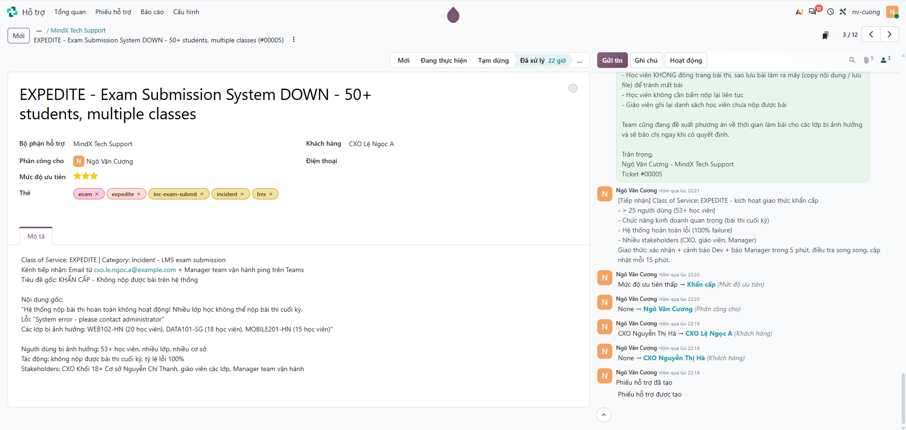

## Bước 2: Phản ứng khẩn cấp (< 5 phút)

Song song: Email 1 xác nhận khẩn cấp cho CXO, cảnh báo Dev/DevOps/Senior trên Teams, trả lời Manager. Chuyển ticket sang **Đang thực hiện**.

<!-- ẢNH: email 1 + ghi chú [Cảnh báo Dev] + ghi chú [Trả lời Manager] + dòng "Mới → Đang thực hiện" -->
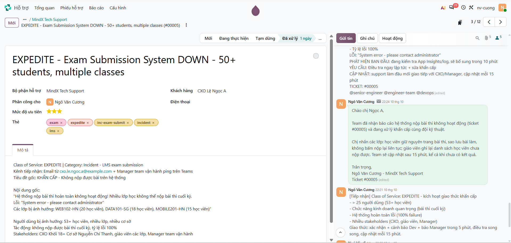

Liên kết 2 ticket liên quan từ giáo viên về ticket chính: thêm người báo vào theo dõi ticket chính, ghi chú [Liên kết] có link tới ticket chính.

<!-- ẢNH: ticket chính #00005, mở danh sách người theo dõi (biểu tượng 👤 trong chatter), thấy Giáo viên Phạm Văn D và Giáo viên Hoàng Thị E -->
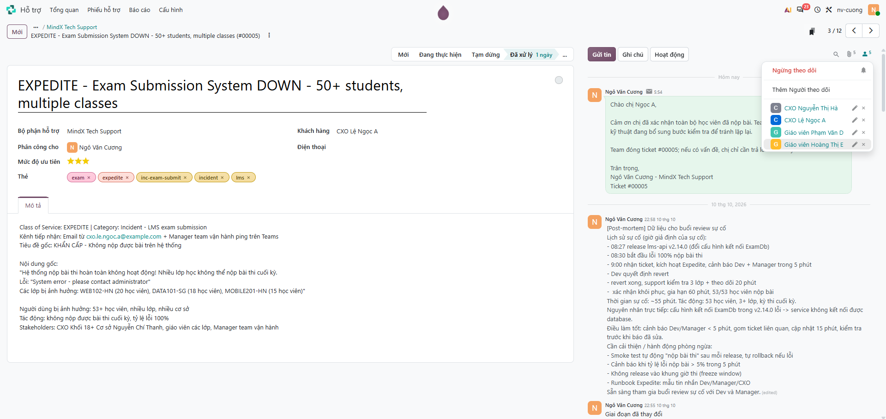

<!-- ẢNH: ticket liên quan #00006 và #00007 lúc tạo: ★★★, thẻ inc-exam-submit, ghi chú [Liên kết] + email xác nhận -->
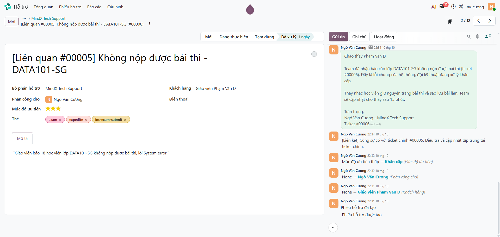

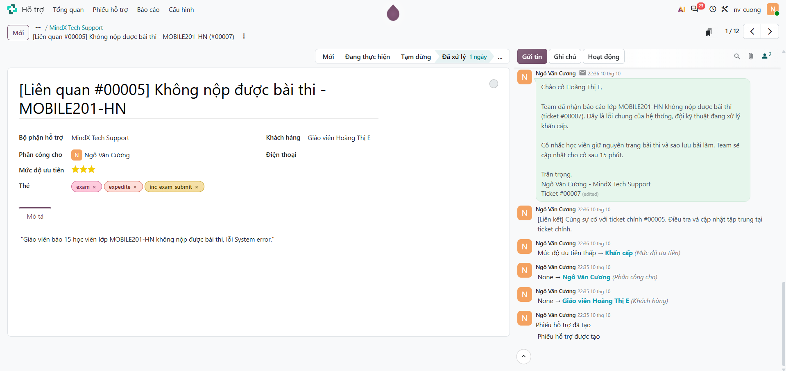

## Bước 3: Thu thập thông tin (< 10 phút)

Kiểm tra App Insights, log, lịch sử release và phạm vi: lỗi 100%, toàn hệ thống, bắt đầu 08:30 ngay sau release v2.14.0, nguyên nhân là lỗi kết nối database.

<!-- ẢNH: ghi chú [Thu thập thông tin] + 5 file bằng chứng đính kèm -->
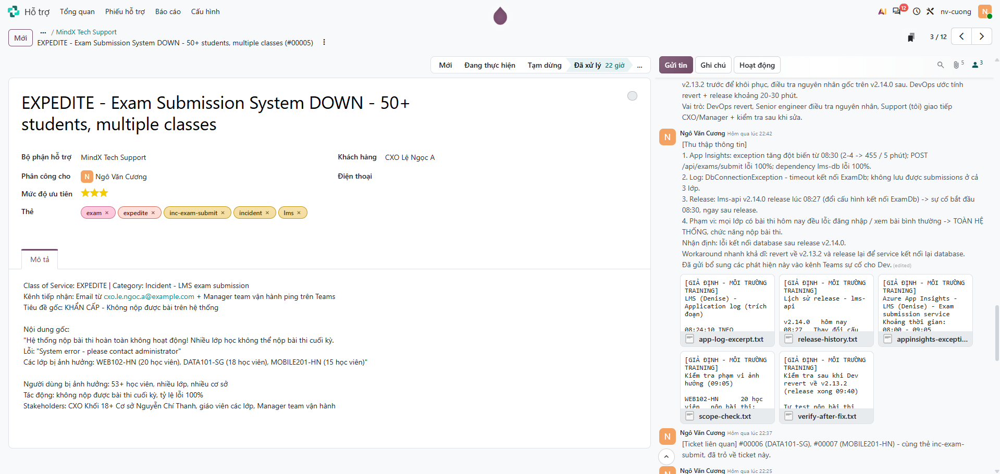

## Bước 4: Escalation, phối hợp và quản lý stakeholders (< 15 phút)

Dev nhận việc và chọn revert. Gửi Manager tóm tắt các phương án và đề xuất. Email 2 cho CXO: nguyên nhân sơ bộ, phương án đang làm, việc học viên cần làm.

<!-- ẢNH: ghi chú [Dev nhận việc] + ghi chú [Gửi Manager] + email 2 -->
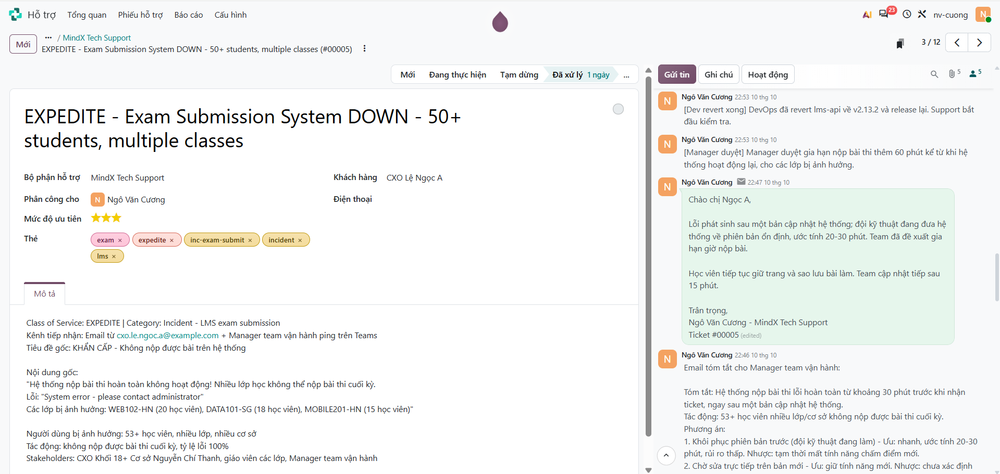

## Bước 5: Giải quyết và xác minh

Dev revert xong. Email 3 báo đang kiểm tra, **chưa** báo đã sửa.

<!-- ẢNH: ghi chú [Manager duyệt] + ghi chú [Dev revert xong] + email 3 -->
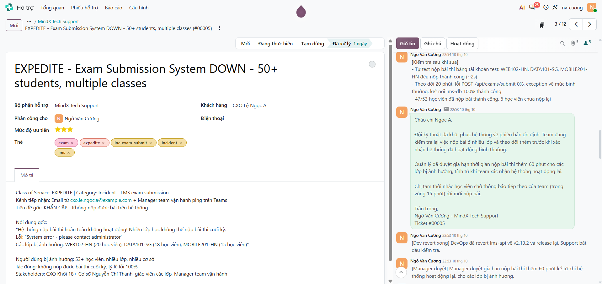

Tự test nộp bài ở 3 lớp và theo dõi 20 phút. Email 4 báo đã khôi phục, cập nhật cho Manager. Chuyển sang **Tạm dừng**.

<!-- ẢNH: ghi chú [Kiểm tra sau khi sửa] + email 4 + ghi chú [Cập nhật Manager] + dòng "Đang thực hiện → Tạm dừng" -->
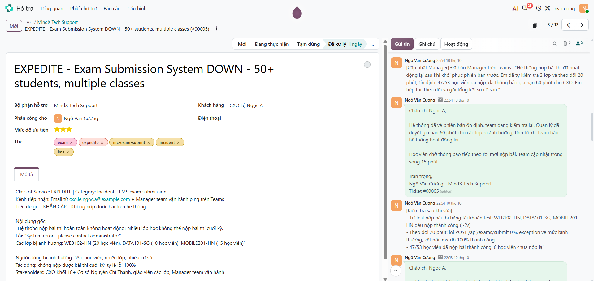

## Bước 6: Theo dõi

CXO xác nhận, Email 5 follow-up, chuyển ticket chính sang **Đã xử lý**; gửi kết quả cho 2 người báo, đóng ticket liên quan sau khi họ xác nhận.

<!-- ẢNH: ghi chú [Theo dõi] + email 5 + dòng "Tạm dừng → Đã xử lý" -->

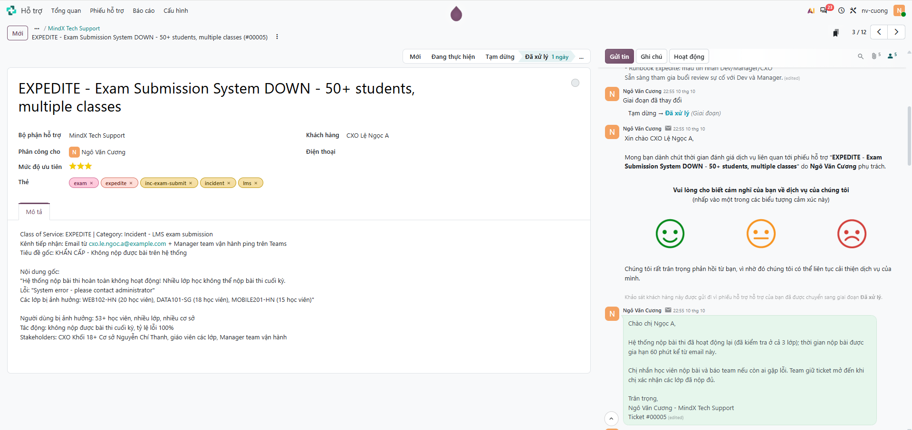

Gửi kết quả cho từng người báo và chuyển **Tạm dừng**; chỉ đóng (**Đã xử lý**) sau khi người báo xác nhận.

<!-- ẢNH: ticket liên quan: email kết quả + "→ Tạm dừng" + ghi chú [Theo dõi] người báo xác nhận + email đóng + "→ Đã xử lý" -->
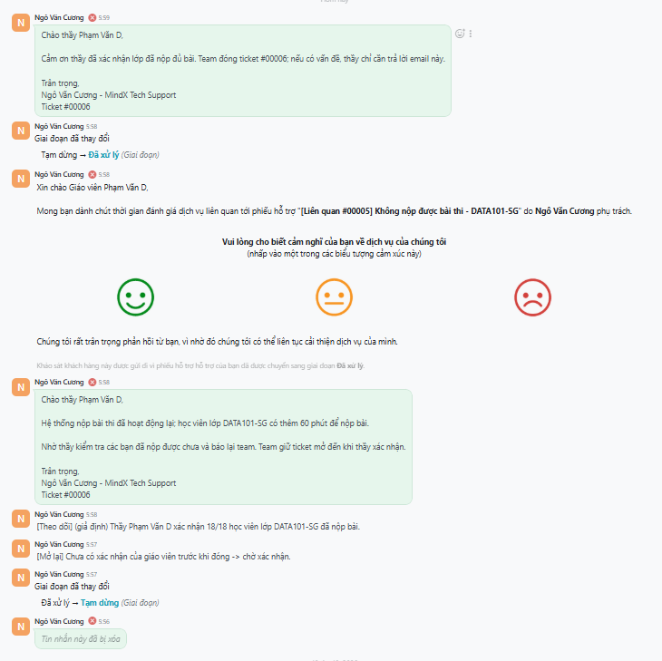

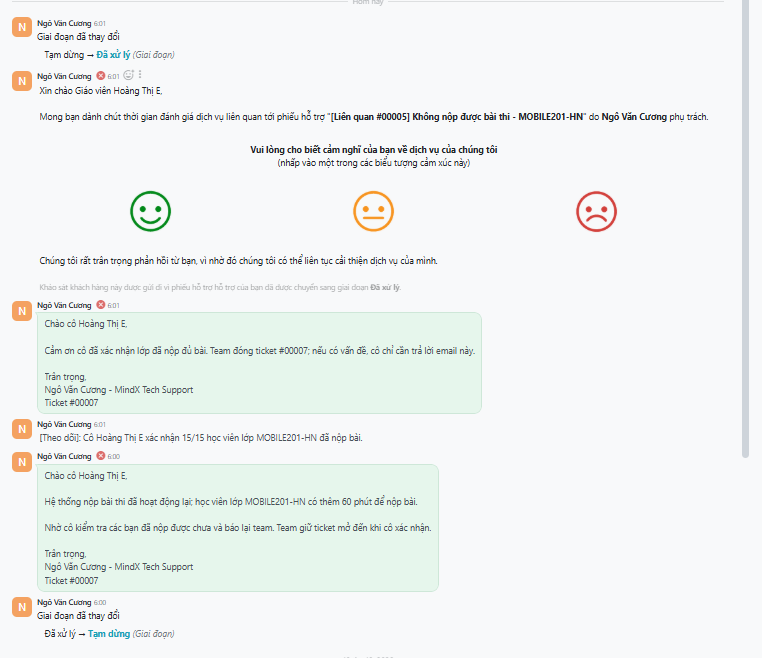

## Bước 7: Sau sự cố (post-mortem)

Tài liệu hoá lịch sử sự cố, dữ liệu cho post-mortem, hành động phòng ngừa; tạo bài Knowledge.

<!-- ẢNH: ghi chú [Post-mortem] -->
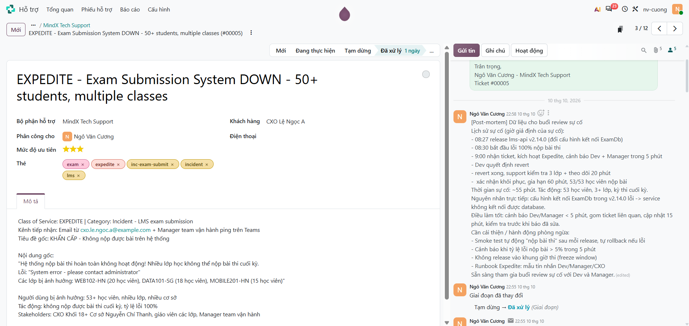

<!-- ẢNH: bài viết trong app Kiến thức -->
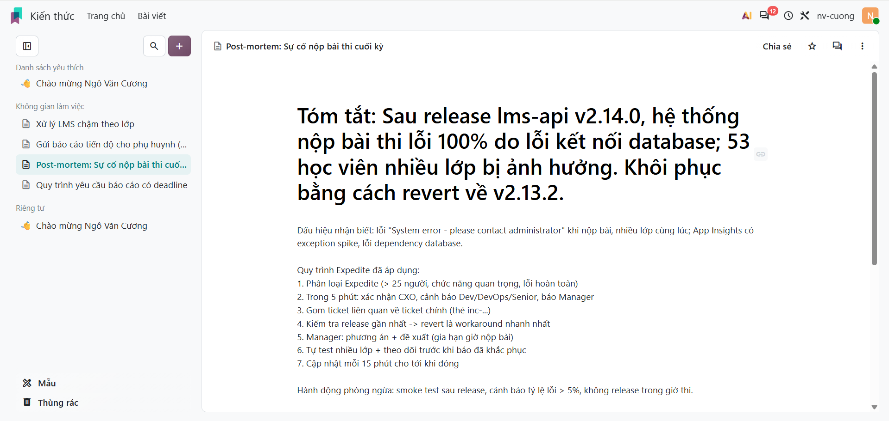

---

Bằng chứng giả lập (đính kèm trong ghi chú thu thập thông tin): [`evidence/scenario-03/`](evidence/scenario-03/)

## Đối chiếu checklist đánh giá

| Tiêu chí | Ở đâu |
|---|---|
| Nhận diện Expedite ngay lập tức | Bước 1 |
| Cảnh báo nhiều stakeholders nhanh, thông báo Manager phù hợp | Bước 2, timeline |
| Dev team có đủ ngữ cảnh, thông tin chi tiết rõ ràng | Bước 2–4 |
| Cập nhật thường xuyên (mỗi 15 phút), giọng bình tĩnh, chuyên nghiệp | Bước 2–5, timeline |
| Mỗi đối tượng nhận nội dung phù hợp | Bảng "Giao tiếp theo đối tượng", bước 4 |
| Có timeline dự kiến (ước tính, không cam kết cứng) | Email 2 |
| Giải pháp tạm thời | Bước 4 |
| Kiểm tra lại sau khi sửa, theo dõi trước khi thông báo | Bước 5 |
| Tài liệu hoá sự cố, post-mortem | Bước 7 |

## Rút kinh nghiệm

<!-- Bản nháp: chỉnh lại theo trải nghiệm của bạn -->

- Với Expedite, cảnh báo Dev trong 5 phút và điều tra song song, không phân tích một mình quá lâu.
- Gom các ticket cùng sự cố về một ticket chính để cập nhật một chỗ, không bỏ sót người báo.
- Mỗi đối tượng một kiểu thông tin: Dev cần log và thời điểm; Manager cần tác động, phương án và quyết định; CXO cần biết học viên phải làm gì và khi nào có cập nhật tiếp.
- Release ngay trước sự cố là manh mối đầu tiên; revert là workaround nhanh nhất trong khi tìm nguyên nhân gốc.
- Không báo "đã sửa" ngay sau khi Dev deploy: tự test nhiều lớp và theo dõi một khoảng thời gian rồi mới thông báo.
- Có thể tự động hoá: cảnh báo khi tỷ lệ lỗi nộp bài > 5%, smoke test nộp bài tự động sau mỗi release, không release vào khung giờ thi.

## Điều chỉnh sau review

- Thêm quan hệ thật trên Odoo cho ticket liên quan: người báo theo dõi ticket chính, ghi chú có link tới ticket chính.
- Email xác nhận #00006, #00007 nêu mốc cập nhật tiếp theo (15 phút).
- #00006, #00007: gửi email kết quả riêng, chờ giáo viên xác nhận rồi mới đóng; sửa xưng hô "cô" ở #00007.
- Rút gọn 5 email cho CXO; thay hết placeholder (`#[CHÍNH]`, `[giờ]`, `[X]`).
