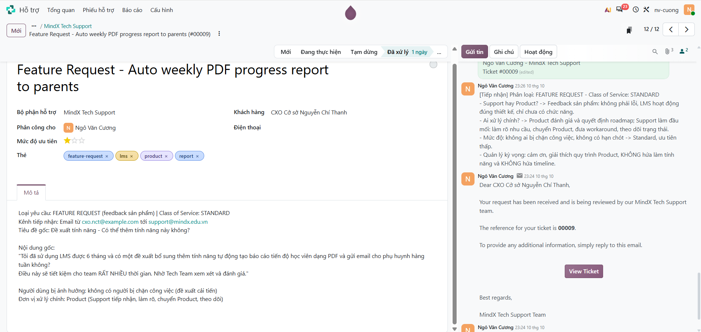
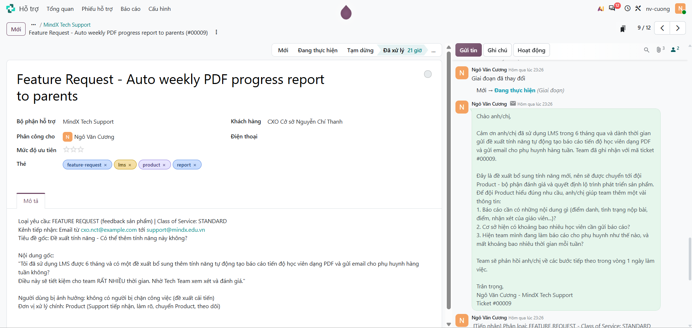
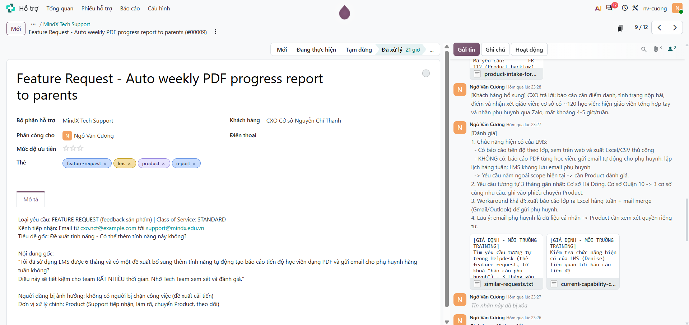
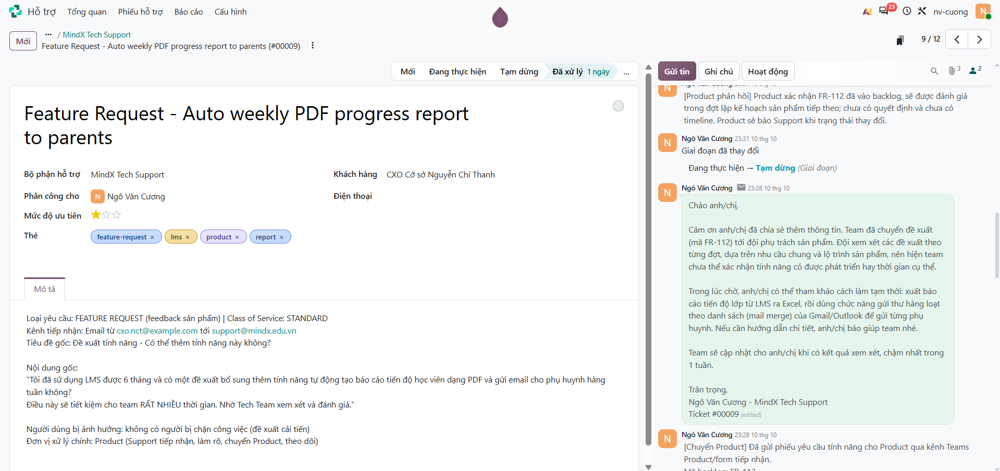
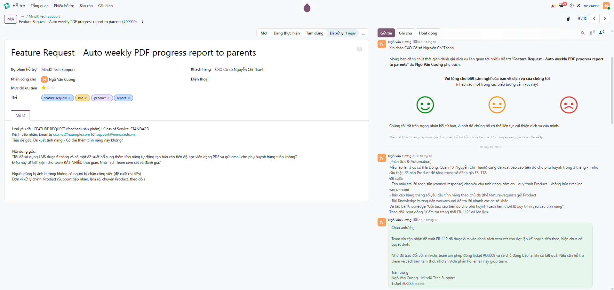
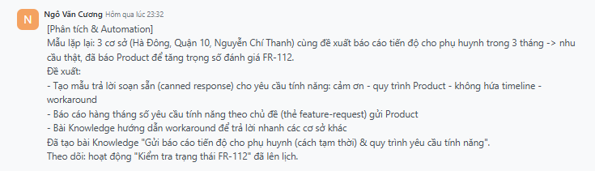
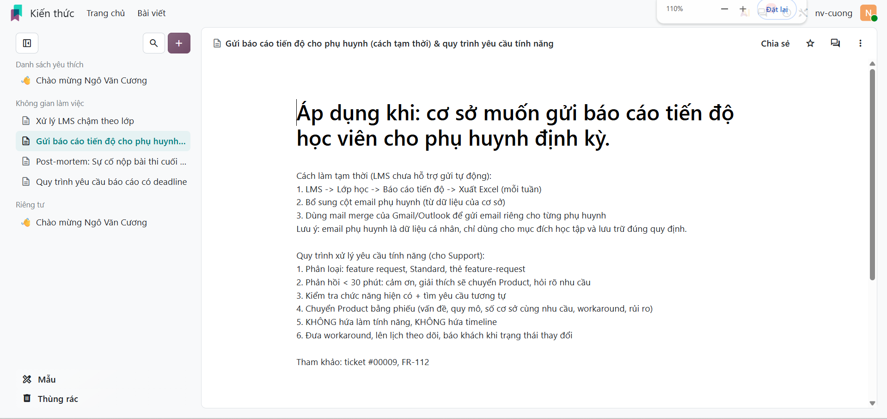

# Scenario 4: Yêu cầu tính năng – báo cáo tiến độ PDF gửi phụ huynh (Standard)

Odoo Helpdesk: https://nv-cuong.odoo.com (đội **MindX Tech Support**). Tình huống training giả định: kết quả kiểm tra chức năng, phản hồi của Product và mã backlog là giả định, khách hàng là liên hệ giả với email `@example.com`, nên dấu ⊗ đỏ cạnh email trong chatter là thư không gửi đi được (cố ý, để không gửi tới người thật).

| Ticket | Nội dung | Link |
|---|---|---|
| #00009 | Feature Request - Auto weekly PDF progress report to parents | `https://nv-cuong.odoo.com/odoo/helpdesk/1/tickets/9` |

## Giải thích phân loại

**Loại yêu cầu: Feedback sản phẩm (Feature Request), không phải yêu cầu support.** Class of Service: **Standard** (ưu tiên 0 sao; thẻ `feature-request`, `lms`, `report`, `product`).

- **Không phải lỗi:** LMS vẫn hoạt động đúng thiết kế, chỉ chưa có chức năng này.
- **Không ai bị chặn công việc:** CXO vẫn làm thủ công được, yêu cầu nhằm tiết kiệm thời gian.
- **Không có hạn chót:** không phải Fixed Deadline.
- **Đơn vị xử lý chính: Product.** Support tiếp nhận, làm rõ nhu cầu, chuyển Product, đưa workaround và theo dõi trạng thái.

## Nguyên tắc quản lý kỳ vọng

- Cảm ơn góp ý, giải thích quy trình Product tiếp nhận và đánh giá.
- **Không hứa** tính năng sẽ được làm và **không hứa timeline**, vì Support không quyết định roadmap.
- Giữ khách hàng gắn kết: đưa workaround dùng được ngay, hẹn báo lại khi trạng thái thay đổi.

## Timeline

> Giờ dưới đây là **giờ theo tình huống giả định** (Standard: phản hồi < 30 phút, cập nhật ≤ 24 giờ). Giờ hệ thống hiển thị trong chatter Odoo là thời điểm thực hành.

| Giờ | Việc | Mốc yêu cầu | Bước |
|---|---|---|---|
| 12/10 09:15 | Nhận email CXO | | 1 |
| 12/10 09:25 | Tạo ticket, ghi chú phân loại | Ghi nhận < 15 phút (10 phút) | 1 |
| 12/10 09:40 | **Email 1 – Xác nhận + làm rõ nhu cầu**, chuyển Đang thực hiện | < 30 phút (25 phút) | 2 |
| 12/10 10:30 | Ghi chú kiểm tra chức năng hiện có, yêu cầu tương tự (2 file) | | 3 |
| 12/10 14:00 | Ghi chú khách hàng bổ sung thông tin | | 3 |
| 12/10 15:30 | Ghi chú chuyển Product (phiếu FR-112); **Email 2 – Đã chuyển Product + workaround**; lên lịch hoạt động theo dõi; chuyển Tạm dừng | ≤ 24h sau email 1 (~6 giờ) | 4 |
| 13/10 10:00 | Ghi chú Product phản hồi | | 5 |
| 13/10 10:30 | Ghi chú CXO phản hồi workaround | | 6 |
| 13/10 11:00 | **Email 3 – Cập nhật trạng thái + follow-up**; chuyển Đã xử lý | ≤ 24h sau email 2 (~19,5 giờ) | 5–6 |
| 13/10 11:30 | Ghi chú phân tích + bài Knowledge | | 7 |

---

## Bước 1: Tiếp nhận và phân loại

Tạo ticket (ưu tiên 0 sao, thẻ feature-request), ghi chú: đây là feedback sản phẩm, đơn vị xử lý chính là Product.

<!-- ẢNH: form ticket + ghi chú [Tiếp nhận] -->

## Bước 2: Phản hồi ban đầu (< 30 phút)

Email 1: cảm ơn, xác nhận ghi nhận là đề xuất tính năng, giải thích sẽ chuyển Product, hỏi thêm thông tin để làm rõ nhu cầu. Chuyển ticket sang **Đang thực hiện**.

<!-- ẢNH: email 1 + dòng "Mới → Đang thực hiện" -->

## Bước 3: Đánh giá

Kiểm tra LMS hiện có gì (chỉ xuất Excel thủ công), xác nhận yêu cầu nằm ngoài scope; tìm yêu cầu tương tự (3 cơ sở); ghi nhận thông tin khách hàng bổ sung.

<!-- ẢNH: ghi chú [Đánh giá] + 2 file đính kèm + ghi chú [Khách hàng bổ sung] -->

## Bước 4: Chuyển Product và workaround

Chuyển Product bằng phiếu FR-112, Email 2: đã chuyển, quy trình đánh giá, workaround dùng ngay. Lên lịch hoạt động nhắc kiểm tra trạng thái. Chuyển sang **Tạm dừng** (chờ Product).

<!-- ẢNH: ghi chú [Chuyển Product] + phiếu đính kèm + email 2 + hoạt động đã lên lịch + dòng "Đang thực hiện → Tạm dừng" -->

## Bước 5–6: Cập nhật trạng thái và theo dõi

Product phản hồi (đã vào backlog, chưa có timeline). Email 3 cập nhật trạng thái, hỏi workaround có dùng được không, đóng ticket và hẹn báo khi trạng thái thay đổi. Chuyển sang **Đã xử lý**.

<!-- ẢNH: ghi chú [Product phản hồi] + email 3 + dòng "Tạm dừng → Đã xử lý" -->

## Bước 7: Phân tích và Knowledge

Ghi mẫu lặp lại (3 cơ sở cùng nhu cầu), đề xuất; tạo bài Knowledge hướng dẫn workaround và quy trình xử lý yêu cầu tính năng.

<!-- ẢNH: ghi chú [Phân tích] -->

<!-- ẢNH: bài viết trong app Kiến thức -->

---

Bằng chứng giả lập (đính kèm trong ghi chú): [`evidence/scenario-04/`](evidence/scenario-04/)

## Đối chiếu yêu cầu

| Yêu cầu | Ở đâu |
|---|---|
| Phân loại: feedback sản phẩm, đơn vị xử lý là Product | Bước 1 |
| Cảm ơn, giải thích quy trình Product | Email 1, Email 2 |
| Kỳ vọng thực tế, không hứa timeline, không hứa điều không kiểm soát được | Email 1–3 |
| Giữ khách hàng gắn kết: workaround | Email 2, bài Knowledge |
| Chuyển Product đánh giá | Bước 4 |
| Ghi nhận trong Odoo (thẻ / loại yêu cầu / ưu tiên) | Bước 1 |
| Theo dõi để cập nhật khi trạng thái thay đổi | Bước 4 (hoạt động lên lịch), Bước 5–6 |
| Email xác nhận / cập nhật – chuyển Product / follow-up | Email 1 / Email 2 / Email 3 |

## Rút kinh nghiệm

<!-- Bản nháp: chỉnh lại theo trải nghiệm của bạn -->

- Phân biệt yêu cầu support (có lỗi, có người bị chặn) với feedback sản phẩm (muốn thêm chức năng) ngay từ đầu để chọn đúng người xử lý.
- "Từ chối" chuyên nghiệp là không hứa thay Product, nhưng cũng không bỏ khách hàng: cảm ơn, giải thích quy trình, đưa workaround.
- Hỏi rõ nhu cầu (nội dung báo cáo, quy mô, tần suất) giúp Product đánh giá nhanh và đúng hơn.
- Gộp các yêu cầu tương tự từ nhiều cơ sở để Product thấy mức độ nhu cầu thật.
- Ghi chú cho Product cả rủi ro dữ liệu cá nhân (email phụ huynh), không chỉ mô tả tính năng.
- Có thể tự động hoá: mẫu trả lời soạn sẵn cho yêu cầu tính năng, báo cáo định kỳ số yêu cầu theo chủ đề gửi Product.
