# Scenario 5: Sự cố nhiều người dùng – video không xem được (Priority)

Odoo Helpdesk: https://nv-cuong.odoo.com (đội **MindX Tech Support**). Tình huống training giả định: kết quả monitoring, log, storage và xử lý của Content Ops là giả định, khách hàng là liên hệ giả với email `@example.com`, nên dấu ⊗ đỏ cạnh email trong chatter là thư không gửi đi được (cố ý, để không gửi tới người thật).

| Ticket | Vai trò | Link |
|---|---|---|
| #00010 | **Ticket chính**: Video playback issue - Lesson 3 (JS-ADV-HN-2412) - 12 users (CXO) | `https://nv-cuong.odoo.com/odoo/helpdesk/1/tickets/10` |
| #00011 | Liên quan: giáo viên lớp JS-ADV-HN-2412 | `https://nv-cuong.odoo.com/odoo/helpdesk/1/tickets/11` |
| #00012 | Liên quan: học viên (mobile) | `https://nv-cuong.odoo.com/odoo/helpdesk/1/tickets/12` |

Branch được xử lý trên Odoo: **Branch A – vấn đề nội dung (signed URL hết hạn)**. Bản soạn đầy đủ của Branch B và C: [scenario-05-branches-b-c.md](scenario-05-branches-b-c.md).

## Giải thích phân loại

**Class of Service: Priority** (ưu tiên ★★ Cao; thẻ `lms`, `video`, `cdn`, `priority`, `js-adv`, `lesson-3`).

- **12 học viên** bị ảnh hưởng (5–25), 3 ticket cùng hiện tượng trong 20 phút → sự cố **multi-user**, không phải lỗi cá nhân.
- **Chặn việc học:** video bài 3 không phát được.
- Không phải Expedite (< 25 người, chỉ 1 bài); không phải Standard (nhiều người cùng bị).

## Quyết định branch dựa trên dấu hiệu

| Dấu hiệu | Branch A (nội dung) | Branch B (hệ thống/CDN) | Branch C (phía người dùng) | Kết quả kiểm tra |
|---|---|---|---|---|
| Phạm vi | Chỉ 1 lesson | Nhiều lesson/khoá | Nhóm nhỏ user | Chỉ Lesson 3, lesson khác OK → **A** |
| Mã lỗi | 403/404 cho file video | 502/504, timeout tăng | Không có lỗi phía server | 403 "Signature expired" → **A** |
| Monitoring | Error rate tổng bình thường | Error rate, response time tăng đột biến | Bình thường | Tổng 0.4%, CDN 5xx không tăng → loại **B** |
| Mạng / thiết bị | Mọi mạng, mọi thiết bị đều lỗi | Mọi nơi | Cùng nhà mạng/extension; Incognito OK | Wifi + 4G, web + mobile, Incognito đều lỗi → loại **C** |
| Storage | File còn, signed URL hết hạn / sai quyền | — | — | Signed URL hết hạn lúc 19:38 → **A** |

**Kết luận: Branch A.** Support không có quyền tạo lại signed URL, nên escalate Dev/Content Ops với đầy đủ ID; trong lúc chờ, đưa workaround cho lớp.

## Timeline

> Giờ dưới đây và trong các ghi chú `[hh:mm]` là **giờ theo tình huống giả định** (sự cố bắt đầu ~19:40). Giờ hệ thống hiển thị trong chatter Odoo là thời điểm thực hành.

| Giờ | Việc | Mốc yêu cầu | Bước |
|---|---|---|---|
| 19:40 | Sự cố bắt đầu (signed URL hết hạn 19:38) | | — |
| 19:45 | Nhận email CXO | | 1 |
| 19:48 | Tạo ticket chính, ghi chú triage | Triage < 5 phút, ghi ticket < 10 phút (3 phút) | 1 |
| 19:52 | Nhận ticket giáo viên → liên kết vào ticket chính (19:53) | | 1 |
| 19:56 | **Email 1 – ACK**; chuyển Đang thực hiện (19:57) | < 15 phút từ khi nhận (11 phút) | 2 |
| 20:03 | Nhận ticket học viên (mobile) → liên kết + ACK (20:04); ghi chú danh sách ticket liên quan (20:05) | 3 ticket trong 20 phút | 1–2 |
| 20:12 | Ghi chú thu thập dữ liệu + 4 file bằng chứng | | 3 |
| 20:15 | Ghi chú quyết định Branch A | | 3 |
| 20:18 | Ghi chú escalate Content Ops (đủ ID) | | 4 |
| 20:24 | **Email 2 – Cập nhật điều tra + escalation + workaround** | ≤ 30 phút sau email 1 (28 phút) | 4 |
| 20:41 | Ghi chú Content Ops đã sửa | | 5 |
| 20:48 | Ghi chú tự kiểm tra + verify 2 user mẫu | | 5 |
| 20:52 | **Email 3 – Đã khắc phục, nhờ xác nhận**; chuyển Tạm dừng | ≤ 30 phút sau email 2 (28 phút) | 5 |
| 21:20 | Ghi chú CXO xác nhận 12/12 + theo dõi 30 phút | | 6 |
| 21:25 | **Email 4 – Follow-up**; chuyển Đã xử lý; đóng 2 ticket liên quan (21:27) | | 6 |
| 21:35 | Ghi chú phân tích + bài Knowledge | | 7 |

Thời gian từ lúc nhận ticket đến lúc khắc phục và xác minh: 19:45 → 20:48 = **63 phút**. Thời gian sự cố: 19:40 → 20:41 = **61 phút**.

---

## Bước 1: Triage và ghi ticket (< 10 phút)

Tạo ticket chính (12 users, bắt đầu ~19:40, thẻ đủ 6), ghi chú triage: 1 lớp hay nhiều lớp, 1 video hay toàn bộ, web hay mobile.

<!-- ẢNH: form ticket chính + ghi chú [Triage] -->
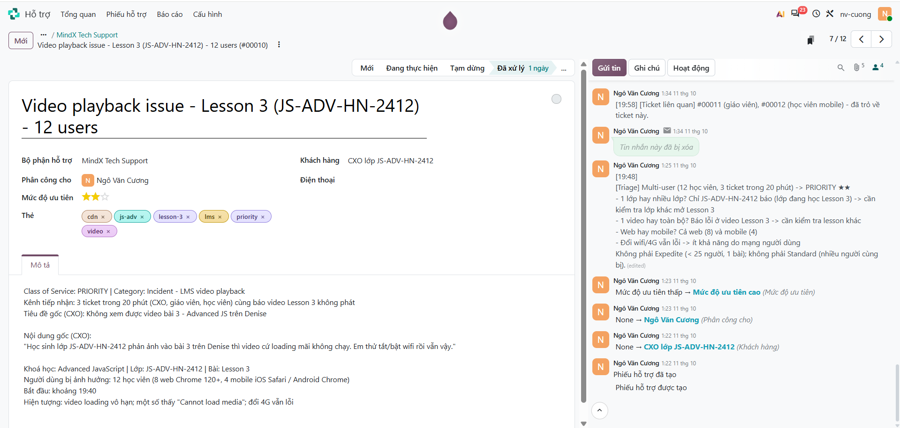

Gom 2 ticket liên quan về ticket chính.

<!-- ẢNH: ticket liên quan #00011 và #00012 lúc tạo: thẻ js-adv + lesson-3, ghi chú [Liên kết] + email xác nhận -->
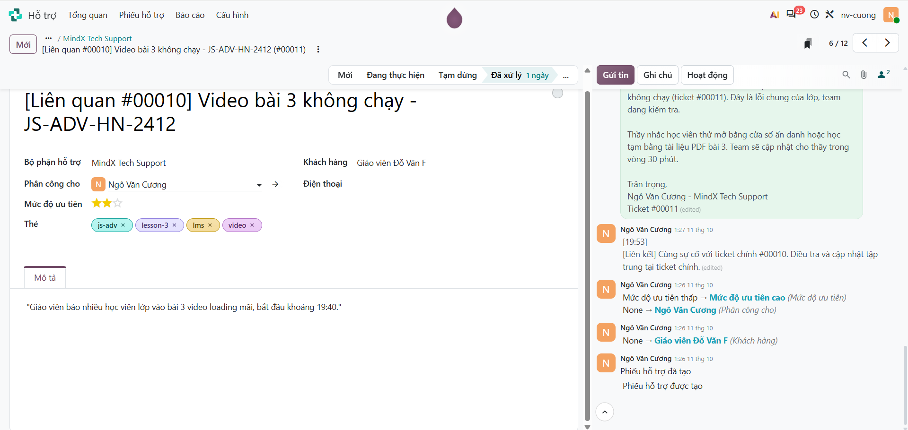

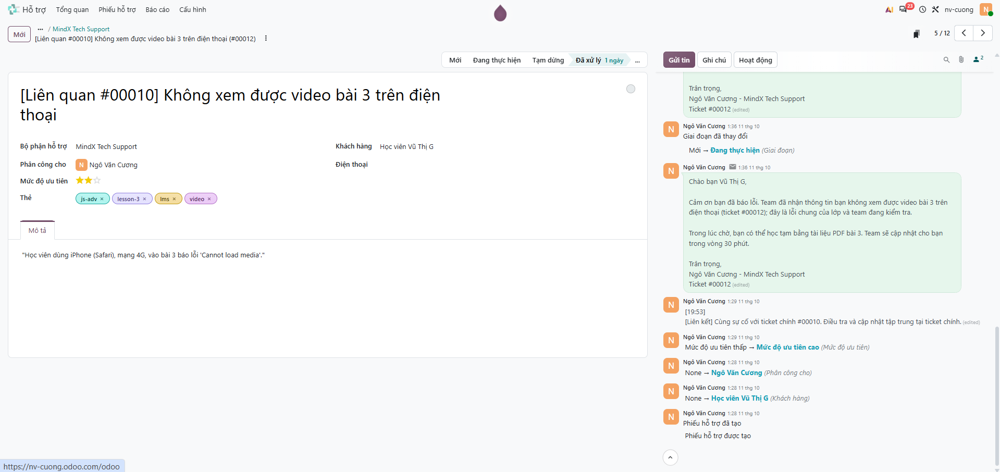

## Bước 2: Phản hồi ban đầu (< 15 phút)

Email 1: xác nhận đang điều phối theo mức Priority, xin 3 thông tin tối thiểu, đưa workaround nhanh, hẹn lần cập nhật tới. Chuyển sang **Đang thực hiện**.

<!-- ẢNH: email 1 + dòng "Mới → Đang thực hiện" -->
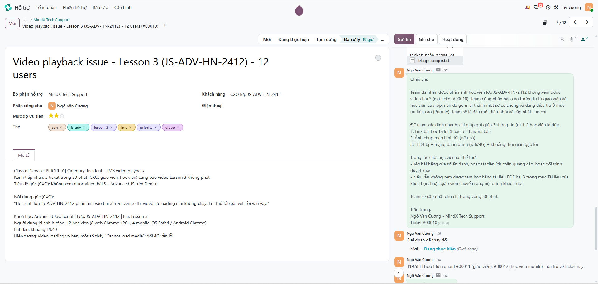

## Bước 3: Thu thập dữ liệu và chọn branch

Kiểm tra monitoring, API gateway log, storage và phạm vi; đối chiếu dấu hiệu với 3 branch → Branch A.

<!-- ẢNH: ghi chú [Thu thập dữ liệu] + 4 file đính kèm + ghi chú [Quyết định branch] -->
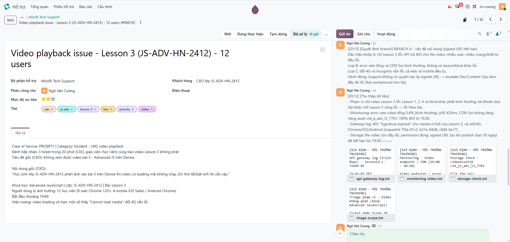

## Bước 4: Escalate và workaround

Escalate Dev/Content Ops với lessonId, videoAssetId, thời điểm, user mẫu, requestId. Email 2: kết quả điều tra, đã chuyển đội kỹ thuật, workaround cho lớp.

<!-- ẢNH: ghi chú [Escalate Content Ops] + email 2 -->
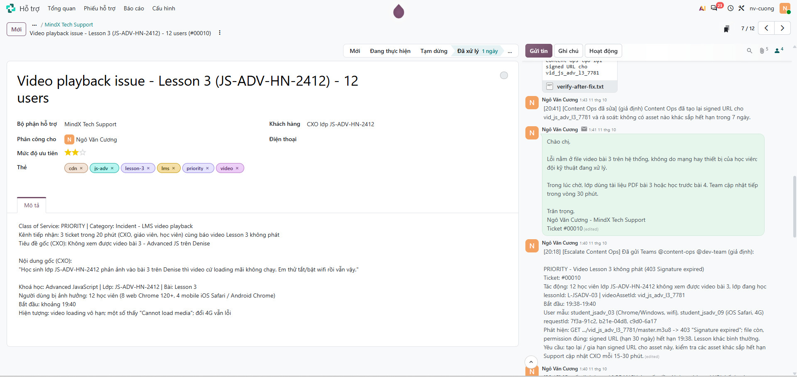

## Bước 5: Giải quyết và xác minh

Content Ops tạo lại signed URL. Tự test web + mobile, verify với 2 user mẫu. Email 3: đã khắc phục, nhờ cả lớp tải lại và xác nhận. Chuyển sang **Tạm dừng**.

<!-- ẢNH: ghi chú [Content Ops đã sửa] + ghi chú [Kiểm tra & verify user mẫu] + email 3 + dòng "→ Tạm dừng" -->
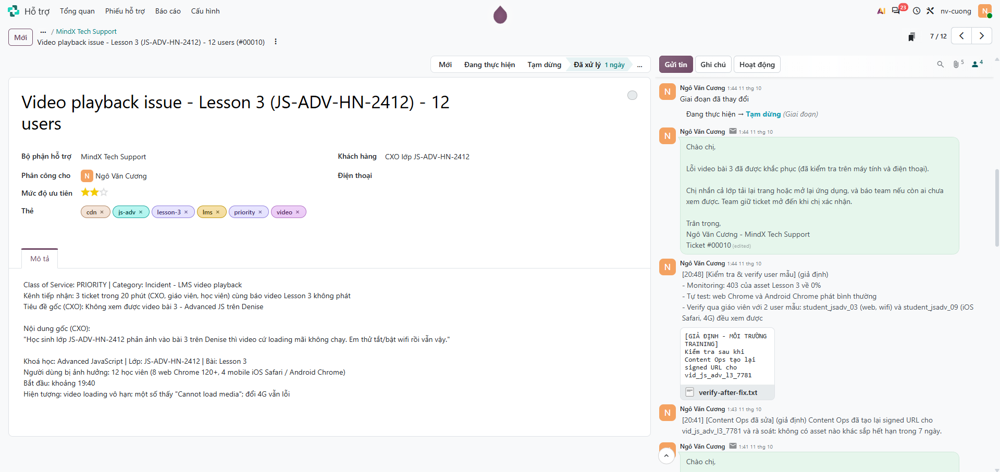

## Bước 6: Theo dõi và đóng

CXO xác nhận 12/12 học viên xem được. Email 4 follow-up, chuyển ticket chính sang **Đã xử lý**; gửi kết quả và đóng 2 ticket liên quan.

<!-- ẢNH: ghi chú [Theo dõi] + email 4 + dòng "→ Đã xử lý" -->

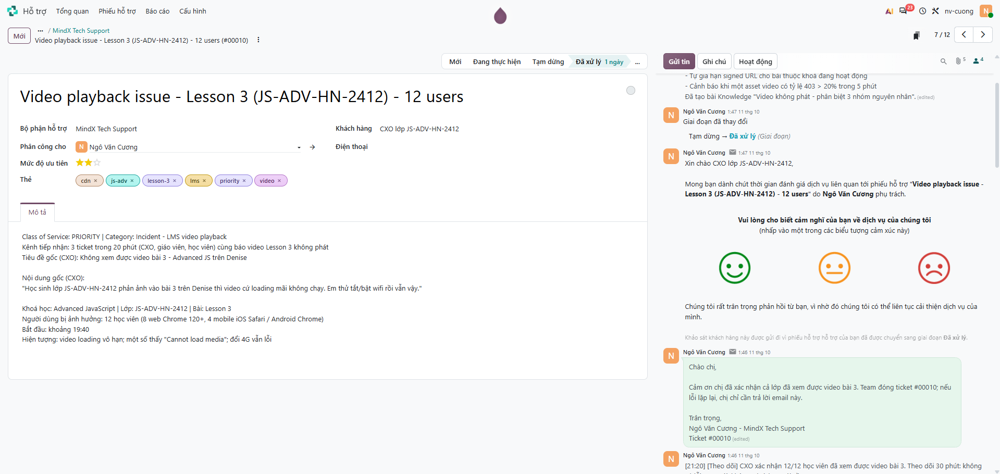

Gửi kết quả và đóng 2 ticket liên quan (Đang thực hiện → Đã xử lý).

<!-- ẢNH: ticket liên quan lúc đóng: email kết quả + dòng "→ Đã xử lý" -->
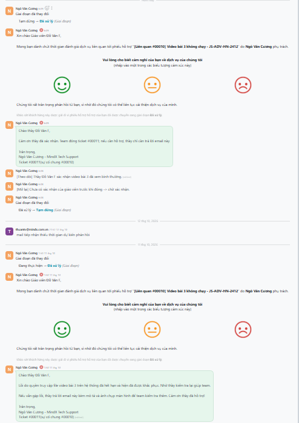

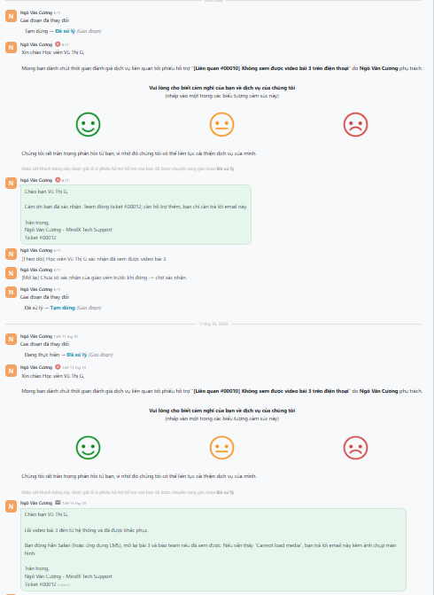

## Bước 7: Phân tích và Knowledge

Nguyên nhân gốc, mẫu lặp lại, đề xuất tự động hoá; bài Knowledge "Video không phát – phân biệt 3 nhóm nguyên nhân".

<!-- ẢNH: ghi chú [Phân tích & Automation] -->
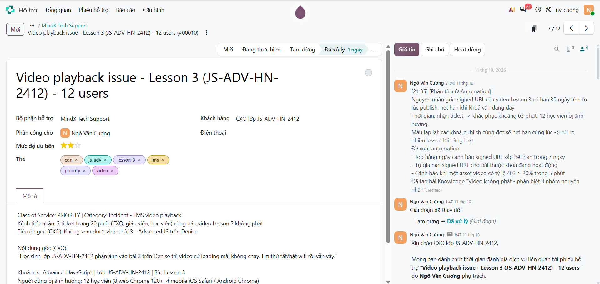

<!-- ẢNH: bài viết trong app Kiến thức -->
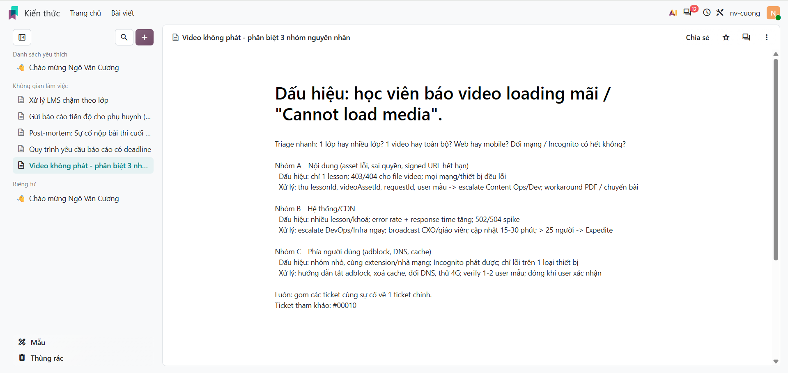

---

Bằng chứng giả lập: [`evidence/scenario-05/`](evidence/scenario-05/)

## Đối chiếu checklist

| Tiêu chí | Ở đâu |
|---|---|
| Ticket chính + relate đúng các ticket liên quan | Bước 1 (ảnh ticket liên quan), Bước 6 (ảnh đóng ticket liên quan) |
| Quyết định branch dựa trên dấu hiệu, không phỏng đoán | Bảng "Quyết định branch", bước 3 |
| Workaround tạm thời + verify với user mẫu | Email 1–2, bước 5 |
| Odoo cập nhật theo timeline, ngắn gọn, có timestamp | Các ghi chú bắt đầu bằng `[hh:mm]`, bảng Timeline |
| Mỗi branch có step-by-step, email/chat draft, update Odoo | Branch A: file này + Odoo; Branch B, C: [scenario-05-branches-b-c.md](scenario-05-branches-b-c.md) |

## Rút kinh nghiệm

<!-- Bản nháp: chỉnh lại theo trải nghiệm của bạn -->

- 3 ticket cùng hiện tượng trong thời gian ngắn là tín hiệu sự cố chung: gom về 1 ticket chính để điều tra và cập nhật một chỗ.
- Triage bằng 3 câu hỏi (1 lớp hay nhiều lớp, 1 video hay toàn bộ, web hay mobile) giúp khoanh vùng nhanh trước khi xem log.
- Chọn branch bằng dấu hiệu đối chiếu được (mã lỗi, phạm vi, mạng/thiết bị), không đoán theo cảm giác.
- ACK nên xin đủ thông tin tối thiểu ngay một lần để không phải hỏi qua hỏi lại.
- Escalate kèm ID cụ thể (lessonId, videoAssetId, requestId, user mẫu) giúp Content Ops sửa ngay.
- Verify với user mẫu trước khi báo cả lớp; đóng ticket khi người dùng xác nhận.
- Có thể tự động hoá: cảnh báo signed URL sắp hết hạn, tự gia hạn khi bài còn đang được dùng.
