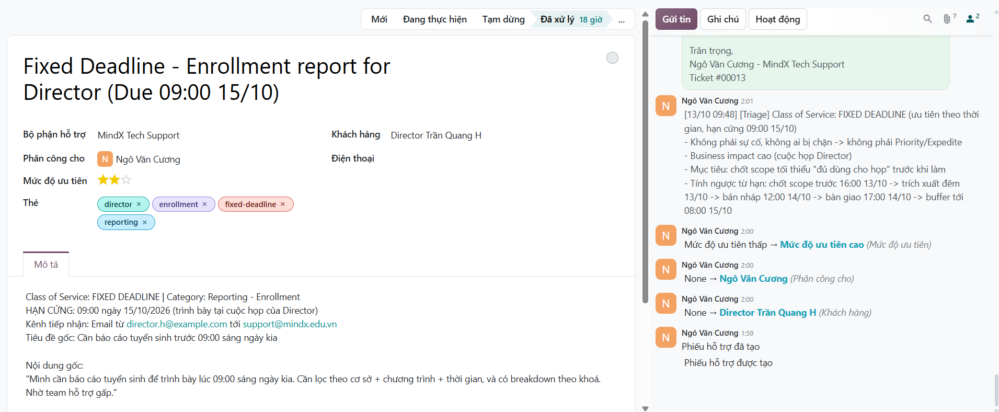
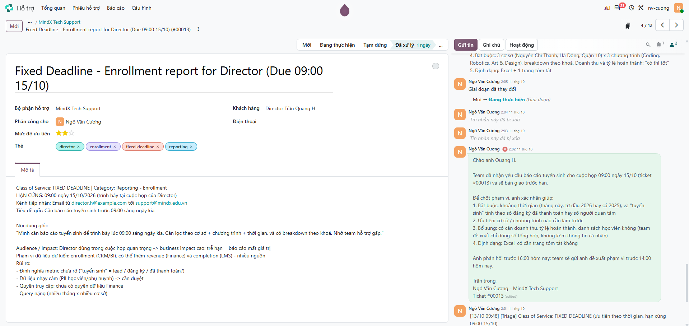
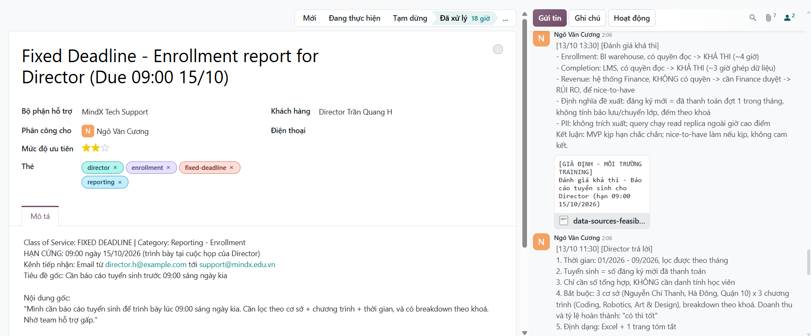
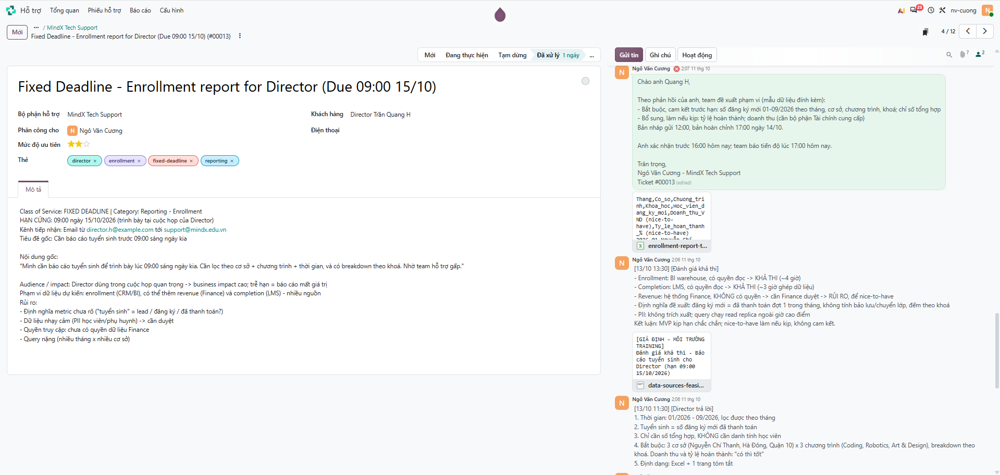
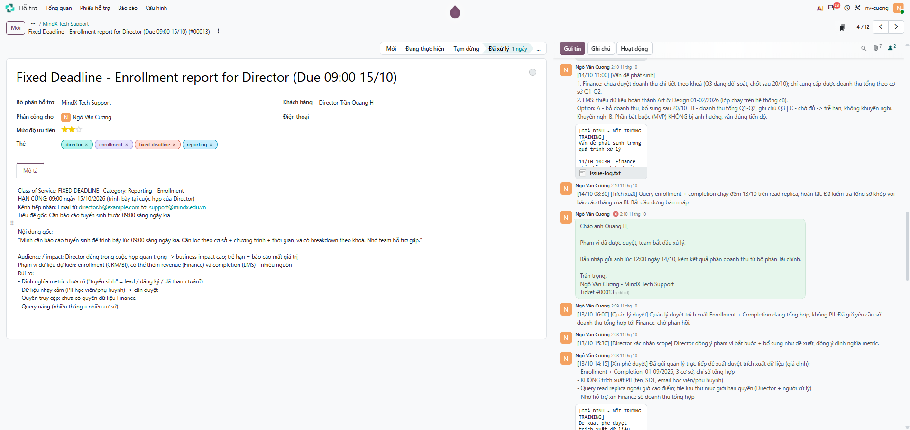
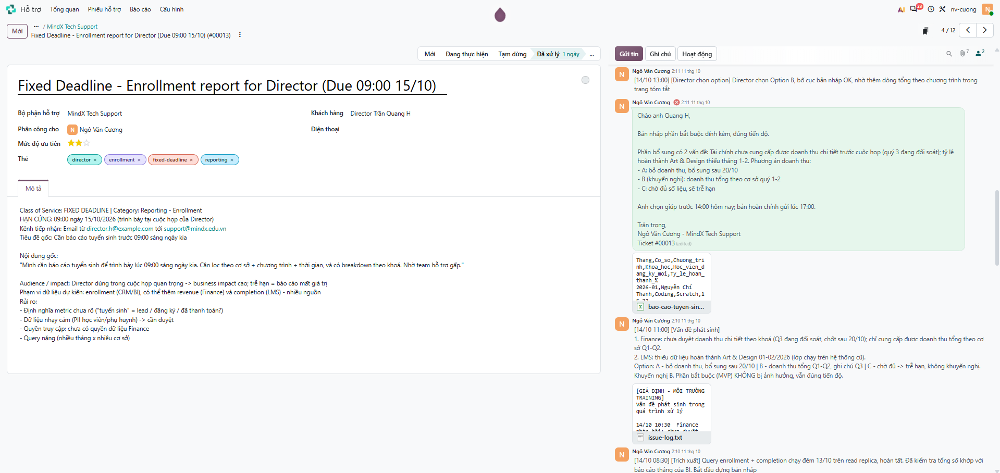
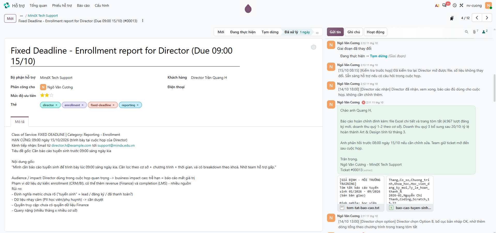
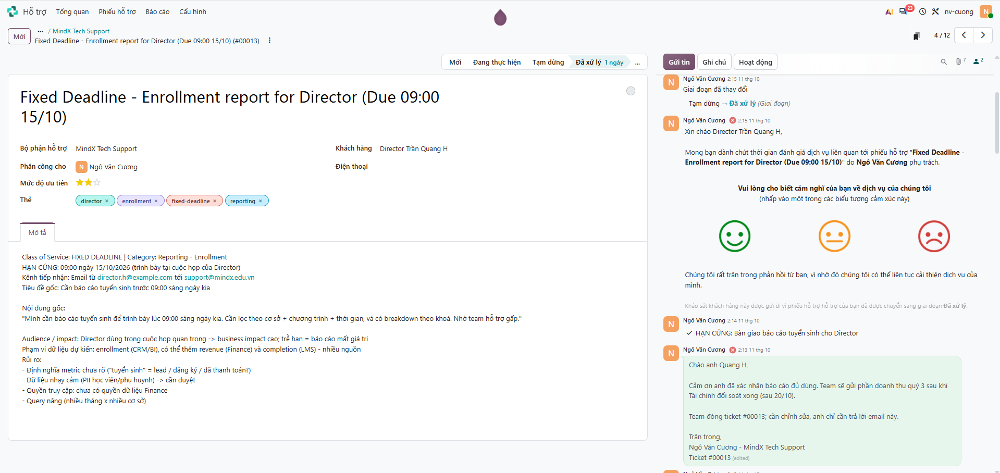
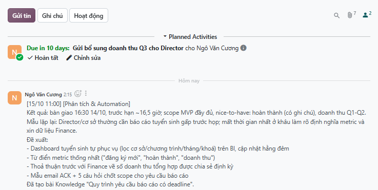
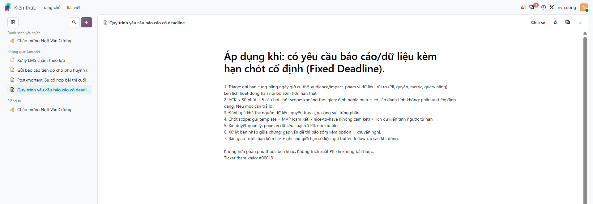

# Scenario 6: Yêu cầu có deadline – báo cáo tuyển sinh cho Director (Fixed Deadline)

Odoo Helpdesk: https://nv-cuong.odoo.com (đội **MindX Tech Support**). Tình huống training giả định: nguồn dữ liệu, phê duyệt, phản hồi của Director/Finance và số liệu báo cáo là giả định, không có PII; khách hàng là liên hệ giả với email `@example.com`, nên dấu ⊗ đỏ cạnh email trong chatter là thư không gửi đi được (cố ý, để không gửi tới người thật).

| Ticket | Nội dung | Link |
|---|---|---|
| #00013 | Fixed Deadline - Enrollment report for Director (Due 09:00 15/10) | `https://nv-cuong.odoo.com/odoo/helpdesk/1/tickets/13` |

## Giải thích phân loại

**Class of Service: Fixed Deadline** (ưu tiên ★★ Cao; thẻ `fixed-deadline`, `reporting`, `enrollment`, `director`).

> Quy ước ưu tiên dùng trong bài: Standard ★ · Priority ★★ · Expedite ★★★ · Fixed Deadline ★★ (theo tác động kinh doanh).

- **Ưu tiên theo thời gian, không theo số người:** hạn cứng 09:00 15/10 cho cuộc họp của Director; trễ hạn thì báo cáo mất giá trị.
- **Tác động kinh doanh cao:** báo cáo dùng để trình bày trong cuộc họp quan trọng.
- **Không phải sự cố:** không ai bị chặn công việc, nên không phải Priority/Expedite.
- **Rủi ro:** yêu cầu ban đầu mơ hồ (chưa rõ khoảng thời gian, định nghĩa "tuyển sinh", có cần danh tính không), dữ liệu nằm nhiều nguồn, có PII, query nặng.

> Đề bài ghi "ngày kia" trong email nhưng "tomorrow" trong tiêu đề gợi ý. Ticket dùng ngày cụ thể (15/10) để không ai hiểu sai hạn chót.

## Scope đã chốt

| | Nội dung | Ghi chú |
|---|---|---|
| **MVP** (bắt buộc cho họp) | Số học viên đăng ký mới, 01–09/2026, lọc theo cơ sở × chương trình × tháng, breakdown theo khoá | Số tổng hợp, không PII |
| **Nice-to-have** | Tỷ lệ hoàn thành theo khoá | Có, trừ Art & Design 01–02/2026 (thiếu dữ liệu) |
| **Nice-to-have** | Doanh thu | Chỉ có tổng theo cơ sở Q1–Q2 (Finance đã đối soát); Q3 bổ sung sau 20/10 |
| **Ngoài scope** | Danh sách/danh tính học viên, so sánh cùng kỳ 2025 | Không cần cho họp, có PII / tốn thời gian |

## Nhánh xử lý khi có vấn đề phát sinh

| Rủi ro | Phương án |
|---|---|
| Director chưa trả lời câu hỏi kịp | Làm theo scope MVP mặc định đã đề xuất, báo rõ giả định |
| Không được duyệt dữ liệu nhạy cảm | Chỉ dùng số tổng hợp, không xuất PII |
| Query nặng / chậm | Chạy trên read replica BI ngoài giờ cao điểm (đêm 13/10) |
| Finance chưa duyệt doanh thu | Option A: bỏ doanh thu · **Option B: doanh thu tổng Q1–Q2 (đã chọn)** · Option C: chờ đủ → trễ hạn, không khuyến nghị |
| Thiếu dữ liệu hoàn thành | Ghi chú rõ phạm vi thiếu trong báo cáo |
| Trễ tiến độ | Bản nháp MVP 12:00 14/10 làm mốc kiểm tra; buffer đến 08:00 15/10 |

## Timeline

> Giờ dưới đây và trong các ghi chú `[dd/mm hh:mm]` là **giờ theo tình huống giả định** (nhận email 09:40 13/10, hạn 09:00 15/10). Giờ hệ thống trong chatter Odoo là thời điểm thực hành.

| Giờ | Việc | Mốc yêu cầu | Bước |
|---|---|---|---|
| 13/10 09:40 | Nhận email Director | | 1 |
| 13/10 09:48 | Tạo ticket, ghi chú triage; lên lịch hoạt động hạn chót | Triage < 10 phút, ghi ticket < 15 phút | 1 |
| 13/10 10:05 | **Email 1 – ACK + câu hỏi chốt scope**; chuyển Đang thực hiện | < 30 phút (25 phút) | 2 |
| 13/10 11:30 | Ghi chú Director trả lời | | 3 |
| 13/10 13:30 | Ghi chú đánh giá khả thi (+ file) | | 4 |
| 13/10 14:00 | **Email 2 – Chốt scope: template, MVP / nice-to-have, timeline** | | 4 |
| 13/10 14:15 | Ghi chú xin phê duyệt quản lý (+ đề xuất duyệt) | | 5 |
| 13/10 15:30 | Ghi chú Director xác nhận scope | | 4 |
| 13/10 16:00 | Ghi chú quản lý duyệt; gửi Finance xin số doanh thu | | 5 |
| 13/10 16:15 | **Email 3 – Đã duyệt, bắt đầu xử lý, timeline dự kiến** | | 6 |
| 14/10 08:30 | Ghi chú trích xuất xong (chạy đêm trên read replica) | | 6 |
| 14/10 11:00 | Ghi chú vấn đề phát sinh (+ issue log) | Raise sớm | 6 |
| 14/10 11:45 | **Email 4 – Vấn đề phát sinh + options + bản nháp MVP** | Bản nháp trước 12:00 | 6 |
| 14/10 13:00 | Ghi chú Director chọn Option B | | 6 |
| 14/10 16:30 | **Email 5 – Bàn giao báo cáo (file)**; chuyển Tạm dừng | Trước hạn ~16,5 giờ | 6 |
| 14/10 18:00 | Ghi chú Director xác nhận đã nhận, đủ dùng | | 6 |
| 15/10 08:15 | Ghi chú kiểm tra lại quyền truy cập file trước họp | Buffer | 6 |
| 15/10 10:30 | **Email 6 – Follow-up sau họp**; hoàn thành hoạt động; chuyển Đã xử lý | | 6 |
| 15/10 11:00 | Ghi chú phân tích + bài Knowledge | | 7 |

---

## Bước 1: Triage và ghi ticket

Tạo ticket với hạn cứng, audience/impact, phạm vi dữ liệu dự kiến, rủi ro; ghi chú triage; lên lịch hoạt động có hạn chót.

<!-- ẢNH: form ticket + ghi chú [Triage] + hoạt động hạn chót đã lên lịch -->

## Bước 2: ACK + hỏi đúng để chốt scope (< 30 phút)

Email 1: xác nhận hạn chót, hỏi 5 câu chốt scope, nêu mốc cần trả lời để kịp hạn. Chuyển sang **Đang thực hiện**.

<!-- ẢNH: email 1 + dòng "Mới → Đang thực hiện" -->

## Bước 3–4: Đánh giá khả thi và chốt scope

Ghi nhận câu trả lời của Director, đánh giá nguồn dữ liệu/rủi ro/công sức. Email 2: gửi template, scope MVP / nice-to-have, định nghĩa metric, timeline, nhánh xử lý rủi ro. Director xác nhận.

<!-- ẢNH: ghi chú [Director trả lời] + ghi chú [Đánh giá khả thi] + file -->

<!-- ẢNH: email 2 + file template -->

## Bước 5: Xin phê duyệt

Gửi quản lý trực tiếp đề xuất duyệt phạm vi dữ liệu, loại trừ PII; quản lý duyệt; gửi Finance xin số doanh thu. Email 3: đã được duyệt, timeline dự kiến.

<!-- ẢNH: ghi chú [Xin phê duyệt] + file + ghi chú [Quản lý duyệt] + email 3 -->

## Bước 6: Xử lý, raise vấn đề sớm và bàn giao

Trích xuất dữ liệu; phát hiện vấn đề (Finance chưa duyệt doanh thu chi tiết, thiếu dữ liệu hoàn thành) → Email 4 với các option và bản nháp. Director chọn Option B. Email 5 bàn giao file. Chuyển **Tạm dừng**.

<!-- ẢNH: ghi chú [Trích xuất] + ghi chú [Vấn đề phát sinh] + email 4 + ghi chú [Director chọn option] -->

<!-- ẢNH: email 5 kèm file + dòng "→ Tạm dừng" + ghi chú [Director xác nhận] + ghi chú [Kiểm tra trước họp] -->

## Bước 6c: Follow-up sau họp

Email 6 hỏi báo cáo có đáp ứng cuộc họp không, nhắc phần doanh thu Q3 bổ sung sau. Đánh dấu hoạt động hoàn thành, chuyển **Đã xử lý**.

<!-- ẢNH: email 6 + hoạt động đã hoàn thành + dòng "→ Đã xử lý" -->

## Bước 7: Phân tích và Knowledge

Mẫu lặp lại (báo cáo tuyển sinh gấp), đề xuất dashboard tự phục vụ, từ điển metric; bài Knowledge quy trình yêu cầu báo cáo có deadline.

<!-- ẢNH: ghi chú [Phân tích & Automation] -->

<!-- ẢNH: bài viết trong app Kiến thức -->

---

Bằng chứng giả lập và file bàn giao: [`evidence/scenario-06/`](evidence/scenario-06/)

## Đối chiếu yêu cầu

| Yêu cầu | Ở đâu |
|---|---|
| Classification: Fixed Deadline | Bước 1 |
| Ticket ghi rõ hạn cứng, audience/impact, phạm vi dữ liệu, rủi ro | Bước 1 (mô tả) |
| Hỏi đúng để chốt scope | Email 1 |
| Gửi template + phạm vi đề xuất để xác nhận | Email 2 |
| Xin phê duyệt quản lý về phạm vi dữ liệu / thông tin nhạy cảm | Bước 5 |
| Phản hồi timeline sau khi được duyệt | Email 3 |
| Raise sớm vấn đề phát sinh + đưa option | Email 4, bảng "Nhánh xử lý" |
| Scope đã chốt (MVP / nice-to-have) | Bảng "Scope đã chốt" |
| Email bàn giao kèm file | Email 5 |
| Timeline + các mốc update | Bảng Timeline |

## Rút kinh nghiệm

<!-- Bản nháp: chỉnh lại theo trải nghiệm của bạn -->

- Với Fixed Deadline, việc đầu tiên là chốt scope tối thiểu đủ dùng cho cuộc họp, không phải bắt tay làm ngay theo yêu cầu mơ hồ.
- Hỏi ít nhưng đúng: khoảng thời gian, định nghĩa metric, có cần danh tính không, phần nào ưu tiên, định dạng; kèm mốc cần trả lời để kịp hạn.
- Tính ngược từ deadline: mốc chốt scope, mốc bản nháp, buffer trước họp.
- Không hứa bừa: phần phụ thuộc bên khác (Finance) để ở nice-to-have.
- Gặp vấn đề thì báo sớm kèm option và khuyến nghị, để người yêu cầu quyết định khi vẫn còn thời gian.
- Dữ liệu nhạy cảm: chỉ trích xuất số tổng hợp và xin duyệt trước khi làm.
- Có thể tự động hoá: dashboard tuyển sinh tự phục vụ có bộ lọc cơ sở/chương trình/thời gian, kèm từ điển định nghĩa metric.

## Điều chỉnh sau review

- Email xác nhận tách rõ **hạn Director cần trả lời** (16:00) và **mốc team gửi đề xuất phạm vi** (14:00).
- Nhóm câu hỏi chốt scope thành phần bắt buộc / bổ sung / định dạng; rút gọn các email chốt scope, cập nhật và bàn giao.
- Email kết thúc chỉ đóng ticket sau khi Director đã xác nhận báo cáo đủ dùng.
